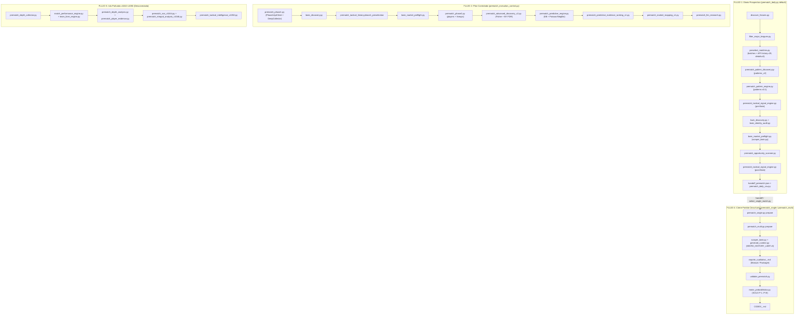

# AUDITORÍA DE ARQUITECTURA REAL — BET ENGINE (PREMATCH)

> **Estado de la auditoría**: Inspección 100% de solo lectura sobre los **76 módulos Python** del repositorio (`73` en raíz, `1` en `config/`, `3` en `tools/`, más `67` archivos de test en `test/`), esquemas JSON, prompts y documentos de diseño previos. Cero modificaciones de código y cero llamadas de red.

---

## 1. DIAGNÓSTICO EJECUTIVO DE LA ARQUITECTURA ACTUAL

El repositorio **no opera como un único pipeline lineal**, sino como la superposición histórica de **cinco generaciones de orquestación y análisis** que coexisten en el directorio raíz plano (`/`):

1. **Flujo Diario Prospectivo por defecto (`prematch_daily.py` -> `prematch_prospective_trial.py` + `prematch_runtime.py`)**: Basado en `preselect_matches.py` (`history=20`, `details=8`), `prematch_pattern_discovery.py` (`patterns_v2`), `prematch_pattern_engine.py` (`patterns`), `prematch_tactical_signal_engine.py`, `bwin_market_preflight.py` y `prematch_opportunity_scanner.py`.
2. **Flujo de Plan Controlado Phase 1 / Phase 2 (`prematch_daily.py prepare|dry-run|run` -> `prematch_execution_control.py`)**: Basado en `prematch_phase1.py` (`Phase1ApiClient` + `DeepCollector`), `prematch_tactical_history.phase1_preselection`, `prematch_phase2.py`, `prematch_advanced_discovery_v2.py` (Fisher + Benjamini-Yekutieli), `prematch_predictive_engine.py`, `prematch_market_mapping_v1.py` y `prematch_llm_research.py`.
3. **Flujo de Investigación Operativa / Librería Táctica (`prematch_daily.py --rank | --prepare-fixture | --tactical-research`)**: Basado en `operational_research` ([prematch_daily.py](file:///Users/antonio/Projects/bet-tactical-engine/prematch_daily.py#L344-L575)) y `daily_tactical_research` ([prematch_daily.py](file:///Users/antonio/Projects/bet-tactical-engine/prematch_daily.py#L578-L625)), que invocan `prematch_tactical_history.evolve_tactical_library`.
4. **Flujo de Cierre Profundo de Partido Único / Lote (`prematch_single.py` / `prematch_multi.py` / `prematch_case.py` / `prematch_release.py`)**: Que vuelve a llamar a `scraper_bwin.py` y `generate_context.py` (`MICRO_HISTORY_LIMIT=6`), espera el informe cualitativo (`reporte_cualitativo_<event>.md`), ejecuta `validate_prematch.py` y corre `motor_probabilistico.py` sobre un máximo rígido de **6 partidos (`P-1..P-6`)** ([motor_probabilistico.py](file:///Users/antonio/Projects/bet-tactical-engine/motor_probabilistico.py#L271)).
5. **Isla Analítica Profunda v1042–v1050 (`match_performance_engine.py` -> `prematch_tactical_intelligence_v1050.py`)**: Una cadena de **11 módulos** de altísimo valor táctico (Strength of Schedule `v1044`, análisis integral `v1046`, distorsión por rojas, mitades H1/H2, arquetipos tácticos `v1050`) que está **completamente desconectada** de `prematch_daily.py`, `prematch_single.py` y `motor_probabilistico.py`.

---

## 2. INVENTARIO COMPLETO DE MÓDULOS Y PUNTOS DE ENTRADA

### 2.1 Clasificación de los 76 archivos Python del repositorio

| Categoría | Archivos | Estado Real en Producción | Consumidores Activos |
| :--- | :--- | :--- | :--- |
| **A. Orquestadores y CLI Principales** | [prematch_daily.py](file:///Users/antonio/Projects/bet-tactical-engine/prematch_daily.py), [prematch_prospective_trial.py](file:///Users/antonio/Projects/bet-tactical-engine/prematch_prospective_trial.py), [prematch_runtime.py](file:///Users/antonio/Projects/bet-tactical-engine/prematch_runtime.py), [prematch_execution_control.py](file:///Users/antonio/Projects/bet-tactical-engine/prematch_execution_control.py), [prematch_single.py](file:///Users/antonio/Projects/bet-tactical-engine/prematch_single.py), [prematch_multi.py](file:///Users/antonio/Projects/bet-tactical-engine/prematch_multi.py), [prematch_case.py](file:///Users/antonio/Projects/bet-tactical-engine/prematch_case.py), [prematch_release.py](file:///Users/antonio/Projects/bet-tactical-engine/prematch_release.py) | **ACTIVOS** (pero con solapamiento funcional entre 4 flujos distintos) | CLI directo, subprocesos cruzados y tests |
| **B. Adquisición API-Football y Contexto** | [discover_fixtures.py](file:///Users/antonio/Projects/bet-tactical-engine/discover_fixtures.py), [filter_major_leagues.py](file:///Users/antonio/Projects/bet-tactical-engine/filter_major_leagues.py), [preselect_matches.py](file:///Users/antonio/Projects/bet-tactical-engine/preselect_matches.py), [prematch_phase1.py](file:///Users/antonio/Projects/bet-tactical-engine/prematch_phase1.py), [prematch_phase2.py](file:///Users/antonio/Projects/bet-tactical-engine/prematch_phase2.py), [generate_context.py](file:///Users/antonio/Projects/bet-tactical-engine/generate_context.py) | **ACTIVOS** (contienen 3 clientes HTTP y cachés distintos) | `prematch_daily`, `prematch_execution_control`, `prematch_multi` |
| **C. Adquisición y Reconciliación Bwin** | [scraper_bwin.py](file:///Users/antonio/Projects/bet-tactical-engine/scraper_bwin.py), [bwin_discovery.py](file:///Users/antonio/Projects/bet-tactical-engine/bwin_discovery.py), [bwin_market_preflight.py](file:///Users/antonio/Projects/bet-tactical-engine/bwin_market_preflight.py), [bwin_identity_audit.py](file:///Users/antonio/Projects/bet-tactical-engine/bwin_identity_audit.py) | **ACTIVOS** | `prematch_prospective_trial`, `prematch_runtime`, `prematch_execution_control`, `prematch_multi` |
| **D. Motores Analíticos y de Patrones (Flujos Diarios y Phase 1/2)** | [prematch_pattern_engine.py](file:///Users/antonio/Projects/bet-tactical-engine/prematch_pattern_engine.py), [prematch_pattern_discovery.py](file:///Users/antonio/Projects/bet-tactical-engine/prematch_pattern_discovery.py), [prematch_tactical_signal_engine.py](file:///Users/antonio/Projects/bet-tactical-engine/prematch_tactical_signal_engine.py), [prematch_tactical_history.py](file:///Users/antonio/Projects/bet-tactical-engine/prematch_tactical_history.py), [prematch_advanced_discovery_v2.py](file:///Users/antonio/Projects/bet-tactical-engine/prematch_advanced_discovery_v2.py), [prematch_llm_research.py](file:///Users/antonio/Projects/bet-tactical-engine/prematch_llm_research.py) | **ACTIVOS** (pero con lógicas e inputs incompatibles entre sí) | `prematch_daily`, `prematch_prospective_trial`, `prematch_execution_control` |
| **E. Modelización Probabilística y Evaluación de Mercados** | [prematch_opportunity_scanner.py](file:///Users/antonio/Projects/bet-tactical-engine/prematch_opportunity_scanner.py), [prematch_predictive_engine.py](file:///Users/antonio/Projects/bet-tactical-engine/prematch_predictive_engine.py), [prematch_predictive_evidence_ranking_v1.py](file:///Users/antonio/Projects/bet-tactical-engine/prematch_predictive_evidence_ranking_v1.py), [prematch_market_mapping_v1.py](file:///Users/antonio/Projects/bet-tactical-engine/prematch_market_mapping_v1.py), [prematch_commercial_models.py](file:///Users/antonio/Projects/bet-tactical-engine/prematch_commercial_models.py), [motor_probabilistico.py](file:///Users/antonio/Projects/bet-tactical-engine/motor_probabilistico.py), [market_quality_gate.py](file:///Users/antonio/Projects/bet-tactical-engine/market_quality_gate.py) | **ACTIVOS / OPCIONALES** (`predictive_engine` y `market_mapping` son opt-in en `daily` pero fijos en `execution_control`) | `prematch_runtime`, `prematch_execution_control`, `prematch_single`, `prematch_multi` |
| **F. Selección, Ranking, Validación y Renderizado** | [rank_matches.py](file:///Users/antonio/Projects/bet-tactical-engine/rank_matches.py), [select_single_match.py](file:///Users/antonio/Projects/bet-tactical-engine/select_single_match.py), [prematch_candidate_selector_v1.py](file:///Users/antonio/Projects/bet-tactical-engine/prematch_candidate_selector_v1.py), [validate_prematch.py](file:///Users/antonio/Projects/bet-tactical-engine/validate_prematch.py), [prematch_context_delta.py](file:///Users/antonio/Projects/bet-tactical-engine/prematch_context_delta.py), [prematch_tactical_report_renderer.py](file:///Users/antonio/Projects/bet-tactical-engine/prematch_tactical_report_renderer.py), [prematch_daily_csv.py](file:///Users/antonio/Projects/bet-tactical-engine/prematch_daily_csv.py), [prematch_ai_packager.py](file:///Users/antonio/Projects/bet-tactical-engine/prematch_ai_packager.py) | **ACTIVOS** | `preselect_matches`, `prematch_daily`, `prematch_single`, `prematch_multi`, `prematch_release` |
| **G. Isla Analítica Profunda v1042–v1050 (Aislada)** | [match_performance_engine.py](file:///Users/antonio/Projects/bet-tactical-engine/match_performance_engine.py), [team_form_engine.py](file:///Users/antonio/Projects/bet-tactical-engine/team_form_engine.py), [prematch_depth_collector.py](file:///Users/antonio/Projects/bet-tactical-engine/prematch_depth_collector.py), [prematch_depth_analysis.py](file:///Users/antonio/Projects/bet-tactical-engine/prematch_depth_analysis.py), [prematch_player_evidence.py](file:///Users/antonio/Projects/bet-tactical-engine/prematch_player_evidence.py), [prematch_quality_audit_v1043.py](file:///Users/antonio/Projects/bet-tactical-engine/prematch_quality_audit_v1043.py), [prematch_depth_v1042.py](file:///Users/antonio/Projects/bet-tactical-engine/prematch_depth_v1042.py), [prematch_sos_v1044.py](file:///Users/antonio/Projects/bet-tactical-engine/prematch_sos_v1044.py), [prematch_sos_pool_v1044.py](file:///Users/antonio/Projects/bet-tactical-engine/prematch_sos_pool_v1044.py), [prematch_sos_reference_collector_v1045.py](file:///Users/antonio/Projects/bet-tactical-engine/prematch_sos_reference_collector_v1045.py), [prematch_integral_analysis_v1046.py](file:///Users/antonio/Projects/bet-tactical-engine/prematch_integral_analysis_v1046.py), [prematch_tactical_intelligence_v1050.py](file:///Users/antonio/Projects/bet-tactical-engine/prematch_tactical_intelligence_v1050.py), [prematch_intelligence.py](file:///Users/antonio/Projects/bet-tactical-engine/prematch_intelligence.py) | **ISLA DESCONECTADA** (solo se invocan entre sí o por CLI manual/tests) | Ningún orquestador diario (`prematch_daily`, `prematch_single`, `prematch_multi`) los llama |
| **H. Experimentos Offline Objective 6 / 6.1** | [prematch_statistical_baseline.py](file:///Users/antonio/Projects/bet-tactical-engine/prematch_statistical_baseline.py), [prematch_international_expansion.py](file:///Users/antonio/Projects/bet-tactical-engine/prematch_international_expansion.py) | **SEMI-AISLADOS** (scripts de corrida offline; `signal_engine` lee su JSON si existe en disco) | [prematch_tactical_signal_engine.py](file:///Users/antonio/Projects/bet-tactical-engine/prematch_tactical_signal_engine.py#L410) lee `objective6_1_international_final_v1` si existe |
| **I. Utilidades Independientes / Legacy / Diagnóstico Sin Consumidores en Prod** | [audit_context_coverage.py](file:///Users/antonio/Projects/bet-tactical-engine/audit_context_coverage.py), [bwin_identity_benchmark.py](file:///Users/antonio/Projects/bet-tactical-engine/bwin_identity_benchmark.py), [bwin_identity_regression.py](file:///Users/antonio/Projects/bet-tactical-engine/bwin_identity_regression.py), [bwin_offline_reconcile.py](file:///Users/antonio/Projects/bet-tactical-engine/bwin_offline_reconcile.py), [generar_prompt_gemini.py](file:///Users/antonio/Projects/bet-tactical-engine/generar_prompt_gemini.py), [generar_prompt_grok.py](file:///Users/antonio/Projects/bet-tactical-engine/generar_prompt_grok.py), [prematch_bwin_diagnose.py](file:///Users/antonio/Projects/bet-tactical-engine/prematch_bwin_diagnose.py), [prematch_cleanup.py](file:///Users/antonio/Projects/bet-tactical-engine/prematch_cleanup.py), [prematch_rehydrate_basic.py](file:///Users/antonio/Projects/bet-tactical-engine/prematch_rehydrate_basic.py), [prematch_retrospective_audit.py](file:///Users/antonio/Projects/bet-tactical-engine/prematch_retrospective_audit.py), [prematch_selection_audit.py](file:///Users/antonio/Projects/bet-tactical-engine/prematch_selection_audit.py), [prematch_v2_coverage_audit.py](file:///Users/antonio/Projects/bet-tactical-engine/prematch_v2_coverage_audit.py), [verify_v213_offline.py](file:///Users/antonio/Projects/bet-tactical-engine/verify_v213_offline.py), [tools/audit_commercial_frozen.py](file:///Users/antonio/Projects/bet-tactical-engine/tools/audit_commercial_frozen.py), [tools/integrate_frozen_research.py](file:///Users/antonio/Projects/bet-tactical-engine/tools/integrate_frozen_research.py), [tools/run_offline_tests.py](file:///Users/antonio/Projects/bet-tactical-engine/tools/run_offline_tests.py) | **STANDALONE / LEGACY** | Solo invocación manual por CLI o por suites de test en `test/` |
| **J. Archivos `.bak` Residuales** | `prematch_depth_analysis.py.bak`, `prematch_depth_analysis.py.bak2`, `prematch_depth_v1042.py.v1043.bak` | **OBSOLETOS** | Ninguno |

---

## 3. RECONSTRUCCIÓN DE LOS FLUJOS REALES DE EJECUCIÓN

### 3.1 Diagrama de los 5 flujos coexistentes



### 3.2 Detalle del Flujo 1 vs. Flujo 2 en `prematch_daily.py`

En [prematch_daily.py](file:///Users/antonio/Projects/bet-tactical-engine/prematch_daily.py#L714-L899), el comportamiento cambia radicalmente según el primer argumento posicional o flags opcionales:
- Si se invoca con subcomando `prepare | dry-run | run` ([prematch_daily.py](file:///Users/antonio/Projects/bet-tactical-engine/prematch_daily.py#L728-L742)), delega por completo en [`prematch_execution_control.execute`](file:///Users/antonio/Projects/bet-tactical-engine/prematch_execution_control.py#L220-L315) (Flujo 2).
- Si se invoca con `--rank`, `--prepare-fixture` o `--tactical-research` ([prematch_daily.py](file:///Users/antonio/Projects/bet-tactical-engine/prematch_daily.py#L743-L745)), ejecuta `operational_research` ([prematch_daily.py](file:///Users/antonio/Projects/bet-tactical-engine/prematch_daily.py#L344-L575)) o `daily_tactical_research` ([prematch_daily.py](file:///Users/antonio/Projects/bet-tactical-engine/prematch_daily.py#L578-L625)) (Flujo 3).
- Si se invoca sin subcomando (modo diario por defecto, [prematch_daily.py](file:///Users/antonio/Projects/bet-tactical-engine/prematch_daily.py#L789-L899)):
  1. Llama a [`prematch_prospective_trial.prepare`](file:///Users/antonio/Projects/bet-tactical-engine/prematch_prospective_trial.py#L338-L558), que corre `discover_fixtures.py`, `filter_major_leagues.py`, `preselect_matches.py` (por lotes mediante `enrichment_resume_plan`), `prematch_pattern_discovery.py`, `prematch_pattern_engine.py`, `prematch_tactical_signal_engine.run_engine` (pre-Bwin), `bwin_discovery.py` y `bwin_identity_audit.py`.
  2. A continuación, llama a [`prematch_runtime.scan`](file:///Users/antonio/Projects/bet-tactical-engine/prematch_runtime.py#L275-L470), que ejecuta `bwin_market_preflight.py`, `prematch_opportunity_scanner.py`, vuelve a correr `prematch_tactical_signal_engine.run_engine` (post-Bwin), genera `handoff_prematch.json` y exporta CSV con `prematch_daily_csv.export_daily`.
  3. Solo si se pasan los flags `--predictive-engine` y `--market-mapping` ([prematch_daily.py](file:///Users/antonio/Projects/bet-tactical-engine/prematch_daily.py#L842-L895)) ejecuta `prematch_predictive_engine.run` y `prematch_market_mapping_v1.map_markets`, pero adaptando `preselection.json` mediante `adapt_preselection_to_phase1_payload` ([prematch_daily.py](file:///Users/antonio/Projects/bet-tactical-engine/prematch_daily.py#L628-L686)) sin haber ejecutado `prematch_phase2.py` ni `prematch_advanced_discovery_v2.py`.

---

## 4. DEPENDENCIAS CIRCULARES Y DUPLICACIÓN DE INFRAESTRUCTURA

### 4.1 Ciclos de importación bidireccionales detectados por AST

| Ciclo Bidireccional | Ubicación Exacta A -> B | Ubicación Exacta B -> A | Impacto Arquitectónico |
| :--- | :--- | :--- | :--- |
| `preselect_matches` <-> `rank_matches` | [preselect_matches.py:553](file:///Users/antonio/Projects/bet-tactical-engine/preselect_matches.py#L553) importa `rank_matches` | [rank_matches.py:96](file:///Users/antonio/Projects/bet-tactical-engine/rank_matches.py#L96) importa `preselect_matches` | Acopla el recolector HTTP de preselección con el clasificador de partidos |
| `preselect_matches` <-> `prematch_tactical_history` | [preselect_matches.py:413](file:///Users/antonio/Projects/bet-tactical-engine/preselect_matches.py#L413) importa `prematch_tactical_history` | [prematch_tactical_history.py:9,77,99](file:///Users/antonio/Projects/bet-tactical-engine/prematch_tactical_history.py#L9) importa `preselect_matches` | Impide usar el historial táctico sin arrastrar `ApiFootball` y la lógica de `preselect_matches` |
| `prematch_tactical_history` <-> `prematch_tactical_signal_engine` | [prematch_tactical_history.py:266](file:///Users/antonio/Projects/bet-tactical-engine/prematch_tactical_history.py#L266) importa `prematch_tactical_signal_engine` | [prematch_tactical_signal_engine.py:20,702](file:///Users/antonio/Projects/bet-tactical-engine/prematch_tactical_signal_engine.py#L20) importa `prematch_tactical_history` | Mezcla almacenamiento longitudinal de observaciones con cálculo de señales y perfiles |
| `prematch_daily` <-> `prematch_prospective_trial` <-> `prematch_runtime` | [prematch_daily.py:18,32,33](file:///Users/antonio/Projects/bet-tactical-engine/prematch_daily.py#L18) importa ambos | [prematch_prospective_trial.py:446,459](file:///Users/antonio/Projects/bet-tactical-engine/prematch_prospective_trial.py#L446) importa `prematch_runtime` | Tres orquestadores comparten estado implícito en `outputs/daily/<date>/` |
| `prematch_single` <-> `prematch_daily` <-> `prematch_release` | [prematch_single.py:28](file:///Users/antonio/Projects/bet-tactical-engine/prematch_single.py#L28) importa `prematch_daily`; [prematch_release.py:13](file:///Users/antonio/Projects/bet-tactical-engine/prematch_release.py#L13) importa `prematch_daily` y `prematch_single` | [prematch_case.py:21](file:///Users/antonio/Projects/bet-tactical-engine/prematch_case.py#L21) importa `prematch_single` | Cuatro wrappers distintos para preparar/cerrar un evento individual |
| `motor_probabilistico` <-> `prematch_context_delta` | [motor_probabilistico.py:1236](file:///Users/antonio/Projects/bet-tactical-engine/motor_probabilistico.py#L1236) importa `EvidenceCache` de `prematch_context_delta` | [prematch_context_delta.py:72](file:///Users/antonio/Projects/bet-tactical-engine/prematch_context_delta.py#L72) importa `motor_probabilistico` | El motor probabilístico depende de su propio auditor de deltas post-contexto |

### 4.2 Cuatro clientes HTTP y sistemas de caché distintos para API-Football

El repositorio mantiene **4 implementaciones independientes** de cliente API-Football con esquemas de caché distintos:

1. **`ApiFootball` en [preselect_matches.py:79-145](file:///Users/antonio/Projects/bet-tactical-engine/preselect_matches.py#L79-L145)**:
   - Caché en `outputs/data/cache/preselect_api/<sha256>.json`, TTL de 12h, rate limit de 3 req/s (`min_interval = 1.0 / 3.0`).
2. **`APIFootballClient` + `JSONCache` en [generate_context.py:860-1120](file:///Users/antonio/Projects/bet-tactical-engine/generate_context.py#L860-L1120)**:
   - Caché en `outputs/data/cache/<sha256>.json`, rate limiter compartido mediante archivo de bloqueo (`SharedAPIRateLimiter`), control de presupuesto por corrida y corte temporal `asof_cutoff`.
3. **`Phase1ApiClient` en [prematch_phase1.py:191-525](file:///Users/antonio/Projects/bet-tactical-engine/prematch_phase1.py#L191-L525)**:
   - Caché versionada por endpoint en `outputs/.api_football_history_cache/<endpoint>/<token>.json` (más snapshots inmutables `__<stamp>__<uuid>.json`). Incluye un adaptador `_read_legacy_cache` ([prematch_phase1.py:345](file:///Users/antonio/Projects/bet-tactical-engine/prematch_phase1.py#L345)) para intentar rescatar entradas de las cachés #1 y #2.
4. **`ApiClient` en [prematch_depth_collector.py:48-112](file:///Users/antonio/Projects/bet-tactical-engine/prematch_depth_collector.py#L48-L112)**:
   - Caché propia en `outputs/depth_cache/` para la isla `v1042–v1050`.

---

## 5. MATRIZ PRODUCTOR / CONSUMIDOR Y FUGA DE DATOS ENTRE ETAPAS

### 5.1 Qué produce cada motor y quién lo consume realmente

| Módulo Productor | Artefacto Generado | Consumidores Reales | ¿Llega a la Decisión Final (`finish` / `CODEX`)? |
| :--- | :--- | :--- | :--- |
| `preselect_matches.py` | `preselection.json` (`statistical_observations`, `home_evidence`, `away_evidence`, `history=20`, `details=8`) | `prematch_pattern_discovery`, `prematch_pattern_engine`, `prematch_tactical_signal_engine`, `prematch_opportunity_scanner` | **NO en `finish`**: `motor_probabilistico.py` no lee `preselection.json` |
| `prematch_pattern_engine.py` | `patterns.json` (asimetrías relativas v0.1) | `prematch_tactical_signal_engine.py` (`legacy_by_fixture`) | **NO** (solo suma hasta +3 pts en el ranking diario) |
| `prematch_pattern_discovery.py` | `patterns_v2.json` (`EXPLICIT` matchup venue y `EXPLORATORY` splits/correlaciones) | `prematch_tactical_signal_engine.py` | **NO** (usado en ranking diario y reporte táctico diario, ignorado por `motor_probabilistico.py`) |
| `prematch_tactical_signal_engine.py` | `tactical_signal_engine.json` + `tactical__report.txt` | `prematch_runtime.py`, `select_single_match.py`, `prematch_daily_csv.py`, `prematch_tactical_report_renderer.py` | **NO en `motor_probabilistico.py`** (solo se usa para elegir el partido en `handoff_prematch.json`) |
| `prematch_opportunity_scanner.py` | `opportunity_scan.json` (`market_signals` Poisson ad-hoc) | `prematch_tactical_signal_engine.py`, `prematch_runtime.py`, `prematch_daily_csv.py` | **NO en `motor_probabilistico.py`** |
| `prematch_advanced_discovery_v2.py` | `outputs/phase2/advanced_patterns.json` (asociaciones 2x2 Fisher + BY FDR) | `prematch_predictive_evidence_ranking_v1.py`, `prematch_market_mapping_v1.py`, `prematch_llm_research.py` | **NO** en el flujo diario por defecto ni en `motor_probabilistico.py` |
| `prematch_predictive_engine.py` | `outputs/phase2/predictive_patterns.json` (Empirical Bayes + Poisson/NegBin por equipo) | `prematch_predictive_evidence_ranking_v1.py`, `prematch_market_mapping_v1.py`, `prematch_llm_research.py` | **NO** en `motor_probabilistico.py` |
| `generate_context.py` | `match_engine_<event>.txt` y `match_engine_<event>.json` (`MICRO_HISTORY_LIMIT=6`) | `validate_prematch.py`, `motor_probabilistico.py` (lee el `.txt` por regex!) | **SÍ**, pero truncado a `P-1..P-6` |
| `motor_probabilistico.py` | `motor_probabilistico_<event>.json` y `.txt` | `prematch_single.py`, `prematch_multi.py`, `CODEX_<event>.md` | **SÍ** (único input cuantitativo del prompt final Codex) |

### 5.2 El Embudo de Pérdida de Datos (`n=20` -> `n=6`)

El hallazgo estructural más grave entre la fase de selección diaria y el análisis profundo del evento (`prematch_single.py finish` / `prematch_multi.py finish`) es el **reseteo y truncamiento de la evidencia**:
1. Durante la fase diaria (`preselect_matches.py` o `prematch_phase1.py`), el sistema descarga hasta **20 partidos históricos por equipo** (`history=20`, `details=8` o `10`) y calcula patrones, estabilidad, leave-one-out (`loo`), asimetrías local/visitante y señales tácticas.
2. Cuando un partido pasa a `prepare`/`finish` ([prematch_multi.py:293-360](file:///Users/antonio/Projects/bet-tactical-engine/prematch_multi.py#L293-L360)), se invoca [generate_context.py](file:///Users/antonio/Projects/bet-tactical-engine/generate_context.py), cuya constante [`MICRO_HISTORY_LIMIT = 6`](file:///Users/antonio/Projects/bet-tactical-engine/config/constants.py#L67) limita la micro-historia impresa a 6 partidos.
3. Posteriormente, [`motor_probabilistico.py:parse_context`](file:///Users/antonio/Projects/bet-tactical-engine/motor_probabilistico.py#L136-L275) **no lee el JSON estructurado ni las observaciones de Phase 1/Preselection**, sino que parsea mediante expresiones regulares el archivo de texto `match_engine_<event>.txt` y aplica un filtro rígido en la línea 271:
   ```python
   if int(match[1]) > 6:
       continue
   ```
4. Como consecuencia, el motor que alimenta la decisión final (`CODEX_<event>.md`) **descarta los partidos `P-7..P-20`**, ignora todas las salidas de `prematch_pattern_discovery.py`, `prematch_tactical_signal_engine.py`, `prematch_advanced_discovery_v2.py` y `prematch_predictive_engine.py`, y recalcula frecuencias crudas (`hits / n` con `n <= 6`) mezclando competiciones en la serie descriptiva principal.

### 5.3 Datos Adquiridos con Coste de API pero Nunca Utilizados Analíticamente

| Dato Adquirido | Dónde se Obtiene | Dónde se Guarda / Imprime | Qué Motor Analítico lo Usa |
| :--- | :--- | :--- | :--- |
| **Historial y perfil disciplinario del árbitro (`RefereeHistoryCollector`)** | [generate_context.py:2221-2435](file:///Users/antonio/Projects/bet-tactical-engine/generate_context.py#L2221-L2435) (hasta 15 partidos del árbitro: `yellow_avg`, `red_avg`, `cards_avg`, `fouls_avg`, `fouls_per_card`, `over_cards_pct`, `over_fouls_pct`) | Impreso en `match_engine_<event>.txt` ([L3303](file:///Users/antonio/Projects/bet-tactical-engine/generate_context.py#L3303)) y `match_engine_<event>.json` | **NINGUNO**. `motor_probabilistico.py` no lo parsea; `prematch_pattern_discovery.py:35` declara explícitamente `'referees': 'NOT_AVAILABLE'`. |
| **Eventos por tramos de 15 minutos (`event_periods`: `00-15` a `76-90+`)** | [generate_context.py:2718-2770](file:///Users/antonio/Projects/bet-tactical-engine/generate_context.py#L2718-L2770) | Impreso en `match_engine_<event>.txt` | **NINGUNO**. Ningún motor de patrones o goles por tramo/mitad consume la cronología de eventos ([prematch_advanced_discovery_v2.py:489](file:///Users/antonio/Projects/bet-tactical-engine/prematch_advanced_discovery_v2.py#L489)). |
| **Bajas / Lesiones (`injuries`) en el flujo principal** | [generate_context.py:2575](file:///Users/antonio/Projects/bet-tactical-engine/generate_context.py#L2575) y [prematch_phase1.py:1110](file:///Users/antonio/Projects/bet-tactical-engine/prematch_phase1.py#L1110) | Guardado en `match_engine_<event>.json` y caché de Phase 1 | **NINGUNO en el flujo principal**. Solo lo leen los módulos aislados [match_performance_engine.py:352](file:///Users/antonio/Projects/bet-tactical-engine/match_performance_engine.py#L352) y [prematch_integral_analysis_v1046.py:266](file:///Users/antonio/Projects/bet-tactical-engine/prematch_integral_analysis_v1046.py#L266). Ni `prematch_phase2.py`, ni `signal_engine`, ni `motor_probabilistico.py` ajustan señales por bajas titulares. |
| **Head-to-Head (`fixtures/headtohead`)** | [generate_context.py:2565](file:///Users/antonio/Projects/bet-tactical-engine/generate_context.py#L2565) y [prematch_phase1.py:1108](file:///Users/antonio/Projects/bet-tactical-engine/prematch_phase1.py#L1108) | Impreso en `match_engine_<event>.txt` y caché de Phase 1 | **NINGUNO**. `motor_probabilistico.py` no parsea la sección H2H; `preselect_matches.py:275` solo mira si ambos IDs coinciden dentro de los últimos 20 partidos de liga. |
| **Endpoints extendidos de Phase 1 (`teams/statistics`, `topscorers`, `topassists`, `topyellowcards`, `topredcards`, `transfers`, `sidelined`, `fixtures/rounds`)** | [prematch_phase1.py:1112-1157](file:///Users/antonio/Projects/bet-tactical-engine/prematch_phase1.py#L1112-L1157) (cuando `core_only=False`) | Guardado en `outputs/.api_football_history_cache/` | **NINGUNO**. `prematch_phase2.py` y `prematch_advanced_discovery_v2.py` solo leen `fixture_bundle` (`statistics`, `players`, `lineups`, `events`) y `standings`. |
| **Predicciones y Cuotas de API-Football (`predictions`, `api_odds`)** | [generate_context.py:2573, 2606](file:///Users/antonio/Projects/bet-tactical-engine/generate_context.py#L2573) (`GET_PREDICTIONS=True`, `GET_API_ODDS=True` en `config/constants.py:57-58`) | Impreso en `match_engine_<event>.txt` | **NINGUNO** (el sistema usa exclusivamente cuotas de Bwin para evaluar mercados, por lo que pedir `api_odds` y `predictions` consume cuota de API innecesariamente). |

---

## 6. CÁLCULOS REPETIDOS E INCOMPATIBLES ENTRE MOTORES

### 6.1 Cinco formas distintas de estimar la tasa esperada ($\lambda$) o probabilidad de un mismo mercado

1. **`prematch_opportunity_scanner.py` ([L185-L214, L328-L333](file:///Users/antonio/Projects/bet-tactical-engine/prematch_opportunity_scanner.py#L185-L214))**:
   - Calcula $\lambda_{\text{home}} = (\text{own\_mean} + \text{opp\_conceded\_mean}) / 2$ sin contracción bayesiana (unshrunk), suma $\lambda_{\text{total}} = \lambda_{\text{home}} + \lambda_{\text{away}}$, aplica una distribución de Poisson y construye bandas `p_low` / `p_high` mediante una perturbación heurística fija ($\pm 25\%$ en goles, $\pm 35\%$ en córners más coeficiente de variación).
2. **`prematch_predictive_engine.py` ([L116-L148, L369-L398](file:///Users/antonio/Projects/bet-tactical-engine/prematch_predictive_engine.py#L369-L398))**:
   - Aplica contracción Empirical Bayes (`shrink(sample, reference, strength=6.0)`) hacia la media de la liga-temporada, mezcla $0.75 \cdot \text{global\_shrunk} + 0.25 \cdot \text{venue\_mean}$ (si $n_{\text{venue}} \ge 3$), y elige entre **Binomial Negativa** (si $n \ge 12$, $\text{var} > 1.2 \cdot \text{mean}$ y $1 \le k \le 100$) o **Poisson**. Sin embargo, **solo modela conteos individuales por equipo** (`own.goals`, `own.corners`, etc.), sin construir la distribución conjunta del total del partido (`home + away`).
3. **`prematch_commercial_models.py` ([L49-L76](file:///Users/antonio/Projects/bet-tactical-engine/prematch_commercial_models.py#L49-L76))**:
   - Usa un estimador empírico de Jeffreys $(k + 0.5) / (n + 1)$ con intervalo de Wilson sobre conteos discretos observados.
4. **`prematch_international_expansion.py` ([L28-L88](file:///Users/antonio/Projects/bet-tactical-engine/prematch_international_expansion.py#L28-L88))**:
   - Usa decaimiento exponencial temporal (`half_life_days = 365.0`) combinado con pooling parcial por estrato (`stratum_prior_weight = 4.0`).
5. **`motor_probabilistico.py` ([L415-L520](file:///Users/antonio/Projects/bet-tactical-engine/motor_probabilistico.py#L415-L520))**:
   - Usa frecuencia empírica cruda `hits / n` sobre un máximo de 6 partidos (`P-1..P-6`), sin contracción, sin ajuste por rival y sin distribución paramétrica.

### 6.2 Tres cálculos incompatibles del descanso (`rest_hours` / `gap_days`)

- En [`prematch_daily.py:459-475`](file:///Users/antonio/Projects/bet-tactical-engine/prematch_daily.py#L459-L475) (`operational_research`), `rest_hours` se calcula sobre `clean_observations`, que filtra **exclusivamente partidos de la misma liga y temporada**. Si un equipo jugó Champions League o Copa hace 68 horas, este cálculo lo ignora y reporta falsamente 7 días de descanso.
- En [`prematch_advanced_discovery_v2.py:222`](file:///Users/antonio/Projects/bet-tactical-engine/prematch_advanced_discovery_v2.py#L222), `context.observed_gap_days` se calcula solo entre las filas presentes en el segmento actual.
- En [`motor_probabilistico.py:1055-1102`](file:///Users/antonio/Projects/bet-tactical-engine/motor_probabilistico.py#L1055-L1102) (`build_competitive_context`), sí se cruzan todas las competiciones presentes en `P-1..P-6` para medir `days_since_prior_kickoff` y detectar compromisos europeos/coperos intercalados.

---

## 7. AUDITORÍA DE COBERTURA Y CONTEXTO MULTICOMPETICIÓN

Contrastando [`AUDITORIA_COBERTURA_MULTICOMPETICION.md`](file:///Users/antonio/Projects/bet-tactical-engine/AUDITORIA_COBERTURA_MULTICOMPETICION.md), [`IMPLEMENTACION_ETAPA1_COBERTURA_TEMPORAL.md`](file:///Users/antonio/Projects/bet-tactical-engine/IMPLEMENTACION_ETAPA1_COBERTURA_TEMPORAL.md) y [`config/coverage_priority.json`](file:///Users/antonio/Projects/bet-tactical-engine/config/coverage_priority.json) con el código real:

1. **Lo que YA está bien implementado**:
   - `config/coverage_priority.json` define una política declarativa `v1.0` (`tiers` `A_FULL`, `B_PARTIAL`, `C_LOW`, `D_MINIMAL`, pesos por endpoint y penalizaciones por campos faltantes).
   - [`preselect_matches.py:473-528`](file:///Users/antonio/Projects/bet-tactical-engine/preselect_matches.py#L473-L528) y [`prematch_phase1.py:1062-1102`](file:///Users/antonio/Projects/bet-tactical-engine/prematch_phase1.py#L1062-L1102) cargan `coverage_priority.json`, evalúan la cobertura declarada de la temporada en el catálogo de ligas (`fixtures/statistics_fixtures`, `events`, `lineups`, `players`, `standings`, `injuries`, `predictions`, `odds`) y priorizan la cola de enriquecimiento (`coverage_priority_score`, `coverage_priority_tier`).
   - El control de corte temporal estricto (`cutoff_utc`) está implementado en [`prematch_phase1.py:720-760`](file:///Users/antonio/Projects/bet-tactical-engine/prematch_phase1.py#L720-L760), [`generate_context.py:1140-1195`](file:///Users/antonio/Projects/bet-tactical-engine/generate_context.py#L1140-L1195) y auditado en [`validate_prematch.py:390-485`](file:///Users/antonio/Projects/bet-tactical-engine/validate_prematch.py#L390-L485).
2. **Dónde se rompe o desaprovecha la cobertura en el núcleo analítico**:
   - **Cobertura declarada vs. cobertura observada por mercado**: Aunque `preselect_matches.py` calcula `coverage_pct` por métrica y `prematch_tactical_signal_engine.py:71-90` distingue `COMPLETA` ($\ge 80\%$), `PARCIAL` ($50\text{–}79\%$) e `INSUFICIENTE` ($<50\%$), `prematch_opportunity_scanner.py` y `motor_probabilistico.py` siguen evaluando mercados cuando $n \ge 4$ sin cruzar contra el tier de cobertura ni diferenciar `dato = 0` de `métrica no cubierta en el proveedor` en todas las familias (p. ej. `offsides` o `blocked_shots` nulos en copas/ligas secundarias).
   - **Ceguera multicompetición en los motores de patrones**:
     - `prematch_pattern_discovery.py:83` (`clean_observations`) descarta cualquier partido cuya `league_id` o `season` no coincida exactamente con la del fixture objetivo.
     - En competiciones de muestra corta (Champions League, Europa League, Copas nacionales, eliminatorias o inicio de temporada con $n < 6$), `clean_observations` se queda sin muestra y el motor produce `INSUFFICIENT_SAMPLE`, a pesar de que el equipo tiene 20 partidos domésticos recientes en la caché.
     - Solo el script offline [`prematch_international_expansion.py`](file:///Users/antonio/Projects/bet-tactical-engine/prematch_international_expansion.py) implementó un prototipo de *partial pooling* por estrato competitivo (`NATIONAL_TEAM`, `CONTINENTAL_CLUB`, `DOMESTIC_CUP`), pero no está conectado al motor de señales ni al motor predictivo en producción.
   - **Calendario posterior (lookahead) y rotación**:
     - Ningún módulo adquiere ni evalúa el **próximo partido tras el fixture analizado** ($T+1$, p. ej. una vuelta de semifinal de Champions 3 días después de un partido de liga), factor clave para anticipar rotaciones masivas antes de tener el XI confirmado.

