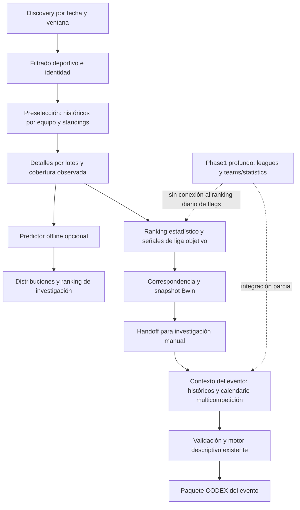

# Auditoría de cobertura estadística y análisis multicompetición

Fecha: 15/11/2026. Repositorio: `/Users/antonio/Projects/bet-tactical-engine`. Rama observada: `codex/prematch-data-pattern-v1`.

## Resumen ejecutivo

**Problema 1: cobertura declarada y cobertura observada no forman un contrato único de selección.** La ruta diaria evalúa históricos, disponibilidad efectiva de métricas y estabilidad. La ruta profunda sí consulta `/leagues`, pero lo hace después de adquirir detalles y no conecta los indicadores de cobertura con el ranking diario. No existe evidencia de que `statistics_fixtures=true` y `standings=true` sean requisitos de máxima prioridad. La clasificación disponible aporta puntos; los flags de cobertura no. Esto permite dedicar presupuesto a lotes sin estadísticas útiles. No prueba por sí solo que se haya desplazado un candidato mejor cubierto.

**Problema 2: existen datos multicompetición, pero su consumo depende de la ruta.** Los históricos de equipo y el contexto incluyen otras competiciones; el núcleo de señales y el predictor restringen las muestras a la liga/temporada objetivo. Hay perfiles de investigación segmentados por competición y contexto competitivo de tabla/calendario en el motor antiguo. No hay integración acreditada de calendario, descanso, rotación o `/teams/statistics` en las probabilidades del predictor nuevo.

No se propone rehacer los colectores: ya existen adquisición profunda, caché por endpoint, calendarios futuros, descubrimiento de competiciones y perfiles individuales. La mejora pendiente es conectar selectivamente estos componentes con contratos verificables, conservando separación entre contexto descriptivo y estimación probabilística.

Esta sesión crea únicamente este informe. No modifica código, módulos, cachés ni snapshots; no consume cuota API ni genera picks. Los cambios de la sesión anterior permanecen y se audita el código actual, sin atribuirlos a esta sesión. La solicitud técnica amplía expresamente el alcance del AGENTS de análisis de un evento: este documento es una auditoría del repositorio, no un análisis de apuesta.

## Evidencia y límites de verificación

- Código real, llamadas y consumidores leídos; referencias de línea corresponden al árbol de trabajo actual.
- Snapshot principal: `outputs/discovery/2026-11-15_1500_0300/evaluations/20261115T195445143219Z_3987d11f552b/prospective_trial/enriched/preselection.json`.
- Auditoría previa contrastada: `api_coverage_audit/summary.json`, `controls.json` y `tactical_comparison.json`, dentro de esa evaluación. SHA del preselection: `6def1a9185d970d64b5ac42baadbb612a9f798ac71ed0e7ffea988f8f0f6359d`.
- Nuevos cálculos de solo lectura: 398 observaciones; 27 pertenecen a competición distinta de la del fixture objetivo; ninguna tiene kickoff igual o posterior al corte de análisis/objetivo. Esto comprueba fechas de partidos, no acredita por sí solo la hora de disponibilidad de cada resultado.
- 85 pruebas offline aprobadas: `test_prematch_predictive_engine`, `test_prematch_predictive_temporal_guard`, `test_prematch_research_profiles`, `test_prematch_tactical_signal_engine`, ejecutadas con unittest y `test/` en sys.path. Los fixtures sintéticos pertenecen exclusivamente a esas pruebas; no se añaden a la evaluación real.
- No se ejecutó discovery, generador, adquisición profunda, validación operativa, motor ni finish sobre datos reales. La existencia de una función acredita implementación, no ejecución en producción.
- Plan Pro, permisos efectivos, catálogo contractual oficial y cobertura actual por competición: **NO VERIFICADO**; no se consultó web ni dashboard.

## Matriz de funcionalidades

Estados: **IMPLEMENTADO Y UTILIZADO** exige consumo visible en la ruta y, cuando se indica, ejecución acreditada por snapshot; **IMPLEMENTADO PERO NO INTEGRADO** significa que existe otra ruta que no alimenta el componente discutido; **IMPLEMENTACIÓN PARCIAL** delimita lo que sí hace; **NO IMPLEMENTADO** se acota al flujo auditado; **NO VERIFICADO** señala ejecución o disponibilidad no acreditadas.

| Funcionalidad | Estado | Evidencia y efecto |
|---|---|---|
| Consulta de coverage por liga/temporada | IMPLEMENTADO PERO NO INTEGRADO con ranking diario | `prematch_phase1.py:1087`, `DeepCollector.collect_fixture`; guarda respuesta de leagues como contexto opcional |
| Caché por endpoint/parámetros y procedencia | IMPLEMENTADO Y UTILIZADO | `preselect_matches.py:78`, `ApiFootball`; `prematch_phase1.py:302`, cliente profundo. Snapshot auditado acredita caché y ledger de preselección |
| Flags statistics_fixtures/standings/events/lineups/statistics_players/players como componentes del ranking diario | NO IMPLEMENTADO en ese ranking | `preselect_matches.py:277`, `331`, `444`; `prematch_daily.py:439`. No hay lectura de esos flags en las fórmulas inspeccionadas |
| Prioridad por estadísticas efectivamente presentes | IMPLEMENTADO Y UTILIZADO | `metric_profile:304`, `score_readiness:331`; n válidos de producción/concesión y estabilidad |
| Prioridad por clasificación disponible | IMPLEMENTADO Y UTILIZADO | `preliminary_score:277` y `score_readiness:331`; la presencia de standings suma puntos, sin usar coverage.standings |
| Jugadores como bonificación de investigación | IMPLEMENTACIÓN PARCIAL | `prematch_daily.py:444`: caché longitudinal con SHA, corte e integridad; bonus máximo 3, no flag declarado ni probabilidad |
| Distinguir booleano coverage de datos presentes | IMPLEMENTACIÓN PARCIAL | La ruta profunda conserva contrato y mide no nulos (`prematch_phase1.py:893`, `915`, `1164`), pero no los reúne en política de selección |
| Histórico multicompetición | IMPLEMENTADO Y UTILIZADO | `preselect_matches.py:591` y `generate_context.py:2128`; sin league en consulta por equipo. Snapshot contiene 27 observaciones de otras competiciones |
| Identificación automática de competiciones | IMPLEMENTADO PERO NO INTEGRADO con ranking diario | `generate_context.py:1864`, `CompetitionDiscovery`; infiere ligas/temporadas de recientes, no todas las inscripciones del equipo |
| Futuro multicompetición | IMPLEMENTACIÓN PARCIAL | `ContextCollector.collect`, `generate_context.py:2545`; fixtures team+next sin liga; horizonte finito, no calendario completo |
| Descanso | IMPLEMENTACIÓN PARCIAL | `prematch_daily.py:457`: penalización por <72 h; `motor_probabilistico.py:1055`: intervalo entre kickoffs descriptivo |
| Acumulación completa de partidos | IMPLEMENTACIÓN PARCIAL | Hay recientes, próximos e intervalos; no se encontró un índice integrado de carga de múltiples semanas con minutos y disponibilidad |
| Desplazamientos | NO IMPLEMENTADO como cálculo de carga en rutas auditadas | Existen venue/localía; no se halló distancia, duración de viaje o penalización usada por ranking/predictor |
| Detección de rotaciones | IMPLEMENTACIÓN PARCIAL en evidencia, NO IMPLEMENTADO como detector conectado | XI, minutos y formaciones existen; no se halló comparación sistemática de XI + exposición + próximos partidos que produzca riesgo de rotación consumido por modelos |
| teams/statistics para ambos equipos | IMPLEMENTADO PERO NO INTEGRADO con preselección/predictor | `prematch_phase1.py:1105`, rama no core_only; liga objetivo, no todas las competiciones |
| Diferenciar tendencia global y competición | IMPLEMENTADO Y UTILIZADO con políticas diferentes | `preselect_matches.py:186`, `229`; `prematch_tactical_history.py:242`, `266`; `motor_probabilistico.py:451` |
| Tabla, puntos y contexto competitivo | IMPLEMENTACIÓN PARCIAL | `standing_for:251` conserva puntos/rango; motor antiguo `build_competitive_context:999` calcula distancias descriptivas, sin modificar p_model |
| Calendario/tabla/descanso dentro de probabilidades | NO IMPLEMENTADO en predictor nuevo | `prematch_predictive_engine.py:362`, `fixture_models`; no consume esos campos para tasas |
| Probabilidades calibradas de apuesta en motor antiguo | NO IMPLEMENTADO por diseño | `motor_probabilistico.py:5`, `415`, `1248`: frecuencias descriptivas y ranking de inspección |
| Predictor de distribuciones independiente | IMPLEMENTADO, ejecución en evaluación concreta NO VERIFICADA | `prematch_predictive_engine.py:362`; opt-in `prematch_daily.py:75`; usa conteos, contracción y localía, con etiquetas de validación limitadas |

## Flujo real, responsables y puntos de corte

El orden no es una única cadena lineal «cobertura declarada antes del ranking». Coexisten rutas; la consulta de contexto completo del seleccionado llega después de la selección inicial.

| Etapa y responsable | Endpoint / parámetros | Obtención, filtros y persistencia | Consumo e influencia |
|---|---|---|---|
| Discovery, `discover_fixtures.py:96`, normalización; `prematch_phase1.py:518` | fixtures date, timezone Europe/Madrid | IDs, competición, equipos, kickoff y estado; ventana y política deportiva; outputs de discovery. coverage_status inicial NOT_AUDITED (`discover_fixtures.py:126`) | Filtrado y candidatos, no contrato de cobertura técnica |
| Histórico de preselección, `run_evaluator`, `preselect_matches.py:553`, `591` | fixtures team, season, from, to; hasta tres temporadas según configuración | Ventana de 550 días en consulta; `prepare_history:160` exige fecha anterior al corte, finalizado, ID único y goles válidos; conserva otras competiciones. Caché preselect_api y preselection JSON/CSV/MD | Histórico básico, recencia, localía, goles y muestra de misma competición; ranking preliminar |
| Clasificación, mismo run_evaluator `:627` | standings league, season | Una consulta por clave liga/temporada; `standing_for:251` exige identificación única. Caché y home/away_evidence | Presencia de tabla suma puntos. Puntos/rango se conservan, no son factor causal táctico |
| Plan de detalle, `select_detail_games`, `preselect_matches.py:229`, `:638` | fixtures ids, lotes hasta 20 | Solo liga/temporada objetivo, FT anterior al corte, orden reciente y cap configurable. No consulta leagues primero | `team_detail:210`, métricas own/conceded; `observations_from_games`, observaciones; ranking factual |
| Ranking, `score_readiness:331`, `assign_ranks:444` | Sin endpoint | Volumen, comparabilidad, presencia de tabla, cobertura de métricas y variabilidad; research_priority combina 70% cobertura y 30% estabilidad cuando existe | Orden de investigación, no precisión validada ni EV |
| Ranking operativo alternativo, `operational_research`, `prematch_daily.py:344`, `:439` | Reutilización de fuentes; reconciliación de horario opcional | Señales, contradicciones, muestra, descanso corto y bonus individual validado. Salidas por runs/ | Puede cambiar prioridad por descanso/individuos; no usa flags leagues |
| Señales, `prematch_tactical_signal_engine.py:151`, `:339`; descubrimiento `prematch_pattern_discovery.py:83` | Sin red | Filtra liga, temporada, equipo, FT y corte; produce señales, contradicciones y ranking táctico | Solo muestras comparables para núcleo; otras competiciones no se transfieren silenciosamente |
| Bwin/handoff, `prematch_daily.py:304`; orquestación `prematch_prospective_trial.py` | Catálogo y preflight Bwin, no API coverage | Identidad, horario, snapshot y oportunidades investigables; handoff_prematch.json | Disponibilidad comercial puede condicionar selección; no demuestra mejor calidad global |
| Contexto seleccionado, `ContextCollector`, `generate_context.py:2530` | fixtures team+last, ids, team+next; standings league+season; otras tareas según configuración | JSON/TXT vía `save_outputs:3512`; flags actuales GET_DEEP_HISTORY, GET_NEXT_MATCHES, GET_STANDINGS activos (`config/constants.py:45`, `48`, `66`). Se inspeccionó configuración solo para capacidades, sin elegir evento | Contexto para investigación, validador y motor existente; futuros e históricos de varias competiciones |
| Colector profundo, `DeepCollector.collect_fixture`, `prematch_phase1.py:1032` | fixtures id/team+last/ids; endpoints históricos; leagues id+season; teams/statistics team+league+season+date | Caché, ledger, raw_manifest y api_coverage; `core_only` omite contexto opcional. Reutiliza payloads embebidos (`adopt_embedded:991`) | Evidencia disponible para bridges; no equivale a que la ruta diaria lo ejecute |
| Investigación ampliada, `prematch_tactical_signal_engine.py:730` y `prematch_tactical_history.py:242`, `266` | Contexto y biblioteca locales | Integra históricos de contexto, forma segmentos competición/temporada/sede/entrenador y condiciones observadas | Reportes de investigación; no convierte mezcla de torneos en señal estable sin revisión |
| Predictor nuevo, `available_observations:287`, `fixture_models:362`, `prematch_predictive_engine.py` | Sin red; preselection | Disponibilidad del resultado al corte, liga/temporada, propias y concesión rival; tasas, contracción a referencia, mezcla localía 75/25 si n>=3, distribución según dispersión | Cambia distribuciones por datos y localía; no por cobertura declarada, tabla, descanso o calendario. Flags RULE_BASED/EXPLORATORY no acreditan calibración de apuestas |
| Motor antiguo y Codex, `prematch_multi.py:519`, `:546` | Sin red en motor; context TXT/JSON, validación y cuotas | finish validado prepara salida probabilistic y CODEX del evento. `motor_probabilistico.parse_context:136` limita a P-1..P-6 y segmenta muestras | Frecuencias y evidencia descriptiva, mapa táctico y contexto competitivo para revisión Codex; no p_model/EV |

## Hallazgos de cobertura

### Lo que ya funciona

La cobertura observada es explícita: `metric_profile` mide n válidos de cuatro series propia/concedida; los ceros numéricos cuentan y las ausencias no se rellenan. Historial y clasificación cuentan antes de adquirir detalle. El ranking factual añade pesos por familia de métricas, por lo que disponer de standings no suple toda la evidencia de tiros/córners.

El código actual conserva campos extra en `EXTRA_METRICS` (`preselect_matches.py:37`) sin incorporarlos a los pesos del ranking. Esto evita inflar su puntuación por corregir el parser. La corrección previa de `observations_from_games` distingue detalle numérico de goles procedentes del histórico (`prematch_tactical_history.py:28`, `:39`).

### Lo que falta conectar

`DeepCollector.collect_fixture` adquiere históricos y detalle antes del contrato leagues. En modo core_only no consulta ese contrato. La preselección no consulta leagues y no usa sus flags; tampoco `/teams/statistics`. El contrato se guarda como respuesta bruta en caché, con scope coverage_contract, pero no se observó un índice liga/temporada que gobierne presupuesto y ranking.

En el código, el filtro de leagues es `{id: league, season: season}` (`prematch_phase1.py:1087`). La expresión `/leagues?league=...` de la solicitud no coincide con el parámetro usado por el cliente; esta auditoría no la ha ejecutado ni pretende verificar el contrato remoto.

`DeepCollector.adopt_embedded` acepta listas embebidas, incluidas vacías, y crea un resultado EMPTY con fuente EMBEDDED_FIXTURES_BATCH. Como devuelve un ApiResult, el fallback al endpoint separado solo ocurre cuando devuelve None (`:1075`). Por tanto, **una lista vacía embebida no dispara contraste con el endpoint específico**. No demuestra falta de datos del proveedor. Debe evaluarse un fallback selectivo, condicionado por contrato/presupuesto; no consultar todo repetidamente.

`AVAILABLE` de DeepCollector.request significa response no vacía, no todas las métricas numéricas (`:966`). La medición no nula posterior `stat_metric_coverage` aporta otra capa. Preselección vacía da n=0 por métrica y baja prioridad factual; no impide investigar goles u otras familias independientes.

### ¿Se eligen partidos peor cubiertos?

La arquitectura lo permite: no hay requisito de flags de cobertura y una candidatura puede tener buenos históricos de goles, tabla y señal descriptiva aunque no tenga tiros/córners. La selección comercial y los filtros de ventana añaden otras restricciones. Pero no se ha demostrado una inversión concreta entre dos candidatos equivalentes, ambos Bwin verificados y con contratos leagues conocidos. **Desplazamiento concreto: NO VERIFICADO.**

### ¿Se desperdicia cuota?

Hay riesgo verificable de consultar detalles sin contrato previo. En la evaluación auditada hubo ocho llamadas de detalle por lotes y muchos bloques vacíos/nulos. No se puede llamar «desperdicio evitable» a todo ello: no se han acreditado flags false por competición ni la respuesta del endpoint específico. Cuarenta accesos reutilizaron caché. Sin esos contratos, no se cuantifica ahorro financiero/API.

## Históricos, calendario y contexto competitivo

1. **Históricos globales y comparables coexisten.** `prepare_history` conserva liga/temporada y muestra global; `team_basic` separa goles globales de misma competición. Los detalles y el núcleo táctico/predictivo se restringen a competición/temporada objetivo. En la muestra real hay 27 observaciones de otras competiciones que pueden aportar goles/recencia, sin acreditar detalle equivalente.
2. **Ejemplo real:** Defensor Sporting, fixture objetivo 1649062. Histórico 1646900 de liga 268 tiene estadísticas; 1638257 y 1635839 pertenecen a liga 930 y están NOT_REQUESTED. Esto prueba recuperación multicompetición y adquisición detallada restringida; no prueba que esas otras ligas carezcan de datos.
3. **Descubrimiento de competiciones:** CompetitionDiscovery agrupa league.id/season de últimos encuentros (`generate_context.py:1875`). No consulta un catálogo completo de participación del equipo. No acredita competiciones sin encuentros recientes.
4. **Futuros:** team+next devuelve varias competiciones sin filtro explícito de liga. Es una muestra finita; no hay barrido de calendarios de todas las competiciones detectadas. El TXT imprime fechas/equipos/estado (`:3421`), mientras el JSON conserva liga, sede y más estructura.
5. **Tabla y diferencias de puntos:** `build_competitive_context` valida evento, fixture, equipos, generación TXT/JSON y tabla por liga/temporada (`motor_probabilistico.py:999`). `_leaderboard_context:942` calcula distancias a zonas. `_next_fixture_info:970` conserva rival/competición/localía, excluye objetivo, pasado y estados distintos de NS/TBD, y usa rango solo para rivales de liga objetivo. La motivación permanece descriptiva; no modifica probabilidades.
6. **Descanso:** motor antiguo toma el último registro entre los históricos parseados P-1..P-6. La ruta operativa alternativa usa `clean_observations`, restringido a liga/temporada, para rest_hours (`prematch_daily.py:457`). **Puede sobreestimar descanso real si hubo copa entre dos jornadas.** Esta consecuencia deriva de los filtros leídos; no se acredita un caso concreto de descanso erróneo en los snapshots examinados.
7. **Rotaciones y viajes:** minutos, XI y calendario son ingredientes existentes. No se halló un cálculo conectado que derive rotación probable o carga de viajes. Una formación o fecha próxima no basta para afirmar rotación.
8. **teams/statistics:** la ruta profunda consulta ambos equipos solo para la competición objetivo y con date al día del kickoff. No consulta sistemáticamente cada competición detectada, ni se encontró consumo directo de esa respuesta en preselección, señal central o tasas del predictor. Además, una fecha diaria no es corte intradía verificable: se debe preservar hora real de adquisición y semántica del proveedor antes de usarla retrospectivamente.
9. **Motor antiguo vs nuevo:** el primero resume frecuencias con desglose same_competition/other_competitions (`motor_probabilistico.py:451`), pero determina igualdad por nombre normalizado de competición en TXT (`:283`), más débil que liga/temporada/ID. El nuevo usa IDs, liga y temporada y modela conteos; no consume el contexto competitivo del primero. Evitar confundir esos dos motores al evaluar integración.

## Control temporal

- Preselección: histórico anterior a min(now,kickoff), fixtures finalizados, deduplicados (`preselect_matches.py:160`, `:585`). Cero kickoffs fuera de corte en las 398 observaciones inspeccionadas.
- Núcleo táctico: filtra fecha, equipo, fixture objetivo, FT, liga y temporada (`prematch_tactical_signal_engine.py:151`).
- Predictor: además exige `result_available_at <= cutoff` (`prematch_predictive_engine.py:287`). Pruebas temporales offline aprobadas.
- Investigación ampliada: al integrar contexto exige FT y al menos tres horas entre kickoff histórico y when; verifica identidad del contexto (`prematch_tactical_signal_engine.py:730`, `:743`).
- Colector de contexto: `DeepHistoryCollector.collect_team_history` no recibe asof ni filtra explícitamente por fecha; si no encuentra finalizados usa todos los fixtures con ID (`generate_context.py:2137`). Los consumidores posteriores deben filtrar; no se debe afirmar que su crudo está congelado por sí solo.
- Phase1 profundo: `final_historical_rows:873` compara con kickoff objetivo, no con self.cutoff, y `request:965` etiqueta adquisición antes del kickoff, no necesariamente antes del corte analítico. Un uso retrospectivo requiere verificar ambos tiempos. Es un límite de garantía, no prueba de fuga real en el snapshot auditado.
- Motor antiguo: parse_context excluye históricos al kickoff (`motor_probabilistico.py:315`); build_competitive_context excluye JSON generado después del kickoff y valida compatibilidad temporal TXT/JSON. Es insuficiente para acreditar automáticamente todos los cortes intermedios de una evaluación anterior.

## Evaluación del criterio propuesto

Exigir statistics_fixtures=true y standings=true para la **máxima categoría de prioridad estadística** es razonable como indicador de capacidad y planificación de adquisición. Debe combinarse con evidencia real reciente por equipo y métrica: un booleano true puede coexistir con bloques nulos. Para copas o formatos sin clasificación útil, standings=false no debe bloquear el análisis de mercados colectivos sustentados por muestras adecuadas.

Events y lineups pueden sumar prioridad cuando alimenten hipótesis/segmentaciones implementadas. Statistics_players y players deberían bonificar investigación individual con exposición verificable, sin ser requisito de tiros/córners colectivos. Flags ausentes o desconocidos necesitan estado UNKNOWN; no false automático. Una familia no debe heredar validez de otra.

No hay evidencia de que aumentar flags true aumente precisión predictiva; medir cobertura, coste y calidad de validación por separado.

## Recomendaciones priorizadas y plan mínimo, sin implementar

| Prioridad | Cambio propuesto | Archivos concretos | Reutilizar / validación necesaria |
|---|---|---|---|
| P0 | Unificar corte de adquisición, resultado e histórico; eliminar garantías basadas solo en kickoff | `generate_context.py` (DeepHistoryCollector), `prematch_phase1.py` (final_historical_rows/request), consumidores de investigación | Reusar result_available_at y controles existentes; pruebas de resultado posterior al corte, pre-kickoff tardío y replay |
| P0 | Mostrar cobertura declarada, observada y no solicitada en campos distintos; nunca interpretar EMPTY de lote como soporte inexistente | `preselect_matches.py`, `prematch_phase1.py`, `prematch_daily.py` | Reusar ledger/cachés y stat_metric_coverage. Prueba de bloques nulos, flags unknown y familias independientes |
| P1 | Consulta/índice de coverage por liga/temporada antes de planificar detalle y prioridad máxima configurable | `prematch_phase1.py`, `preselect_matches.py`, `prematch_daily.py` | Reusar cliente y cache leagues; sin nueva capa de red. Comparar coste y recuperación real antes de activar criterio |
| P1 | Contraste selectivo de endpoint específico cuando lote vacío y exista utilidad/soporte o incertidumbre material | `prematch_phase1.py` (adopt_embedded/collect_fixture), adaptador de adquisición de preselección | Presupuesto/reserva, caché y deduplicación existentes; primero dashboard, no fallback ciego en todos los partidos |
| P1 | Calcular descanso/carga desde últimos encuentros de todas las competiciones, manteniendo muestras de rendimiento separadas | `prematch_daily.py`, `prematch_tactical_history.py`, `generate_context.py` | Reutilizar histórico global y team+next; prueba con copa intermedia y fixture objetivo excluido |
| P1 | Exponer teams/statistics y contexto competitivo en investigación con procedencia, sin multiplicadores ad hoc de probabilidad | `prematch_tactical_signal_engine.py`, `prematch_tactical_report_renderer.py`, `motor_probabilistico.py` | Reusar respuestas profundas y build_competitive_context; verificar IDs, temporada, fecha y comparabilidad |
| P2 | Evaluar características de calendario/tabla/carga para predictor mediante validación temporal fuera de muestra | `prematch_predictive_engine.py` | Reusar feature contracts y walk-forward; incorporar solo si mejora métricas justificadas |
| P2 | Detector descriptivo de cambios de XI/exposición y carga de minutos, previo a afirmar rotaciones | `prematch_phase2.py`, `prematch_tactical_history.py`, renderer | Reusar jugadores, lineups y coaches; separar nominal/funcional y reportar incertidumbre |
| P2 | Sustituir equivalencia de competición por nombre del TXT por IDs/temporada desde JSON y revisar cap P-6 | `motor_probabilistico.py`, `generate_context.py` | Evitar romper contratos; mantener trazabilidad y segmentación actual |

Secuencia mínima: (1) contratos temporales y disponibilidad; (2) puente de cobertura para adquisición/ranking, configurable; (3) descanso global y contexto visible; (4) evaluar variables predictivas sin alterar probabilidades hasta validarlas. No duplicar CompetitionDiscovery, DeepCollector, cachés, calendario próximo ni colector longitudinal.

## Entrega y decisión pendiente

El flujo ya dispone de buena parte de la adquisición requerida. Las principales carencias son integración y garantías de corte, no inexistencia general de históricos o calendarios. La ejecución auditada permite verificar datos observados y pérdidas de cobertura, pero no contratar garantías del plan Pro ni atribuir toda ausencia a la API.

La implementación queda pendiente de revisión de este informe. No se ha modificado ninguno de los archivos de código enumerados en esta sesión.
