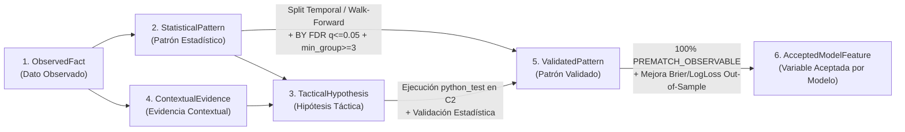

# AUDITORÍA DEL NÚCLEO ANALÍTICO — PATRONES, SEÑALES, HIPÓTESIS Y LLM

> **Propósito**: Diseccionar cómo el código actual descubre, calcula, filtra, valida o pierde patrones futbolísticos; cómo interviene hoy el LLM; qué joyas analíticas existen desconectadas en el repositorio; y qué contratos de datos formales deben separar las 6 categorías epistémicas.

---

## 1. RADIOGRAFÍA DE LOS MOTORES ANALÍTICOS EXISTENTES

Actualmente **no existe un único cerebro analítico**, sino **7 motores distintos** repartidos entre el flujo diario, el flujo Phase 1/2, el cierre de partido (`finish`) y la isla `v1042–v1050`:

| Motor | Archivo y Líneas | Nivel de Abstracción | Entrada Real | Método de Descubrimiento / Cálculo | Validación Estadística |
| :--- | :--- | :--- | :--- | :--- | :--- |
| **1. Pattern Engine V0.1** | [prematch_pattern_engine.py:160-255](file:///Users/antonio/Projects/bet-tactical-engine/prematch_pattern_engine.py#L160-L255) | Descriptivo básico | `preselection.json` (`home_evidence`, `away_evidence`) | Punto medio $(\text{own\_mean} + \text{opp\_conceded\_mean})/2$ y asimetría relativa $\ge 30\%$ en 4 métricas (`goals, corners, shots, yellow`) | Solo exige $n \ge 8$ en las 4 series (`SAMPLE_MIN=8`). Sin test ni holdout. |
| **2. Pattern Discovery V2.0** | [prematch_pattern_discovery.py:83-370](file:///Users/antonio/Projects/bet-tactical-engine/prematch_pattern_discovery.py#L83-L370) | Descriptivo + Exploratorio | `statistical_observations` filtradas a misma liga/temporada (`clean_observations`) | **Explícito**: cruce localía (`home_home` vs `away_away`, $n \ge 4$, cobertura $\ge 40\%$). **Exploratorio**: split `HOME_VS_AWAY`, `RECENT_VS_PREVIOUS` ($5$ vs $5$), y correlación de Pearson en **solo 3 pares fijos** (`shots-corners`, `blocked_shots-corners`, `fouls-yellow`). | Rango Leave-One-Out (`loo`), coeficiente de variación (`cv`), acuerdo reciente vs previo. Sin control FDR ni holdout. |
| **3. Tactical Signal Engine V2.0** | [prematch_tactical_signal_engine.py:171-335](file:///Users/antonio/Projects/bet-tactical-engine/prematch_tactical_signal_engine.py#L171-L335) | Agregador de señales | `preselection.json`, `patterns_v2.json`, `opportunity_scan.json`, `profiles.json` | Construye una señal por cada una de las 8 métricas (`goals, corners, shots, on_target, fouls, yellow, offsides, xg`) ponderando `sample` (20%), `coverage` (20%), `stability` (25%), `agreement` (15%), `sensitivity` (10%), `venue` (5%) y `profile` (5%). | Penaliza contradicciones (`OWN_PRODUCTION_VS_RIVAL_CONCESSION_DISAGREE`, `OPPOSITE_RECENT_TRENDS`, `VENUE_VS_GLOBAL_DISAGREE`). |
| **4. Tactical History & Library** | [prematch_tactical_history.py:186-465](file:///Users/antonio/Projects/bet-tactical-engine/prematch_tactical_history.py#L186-L465) | Reglas booleanas longitudinales | `statistical_observations` / caché enriquecida | Evalúa reglas booleanas JSON (`all`/`any`, `gt, ge, lt, le, eq, ne`, referencias campo-a-campo) con $n \ge 6$: si `hit_rate >= 0.75` -> `DESCRIPTIVE_REGULARITY`; si `< 0.50` -> `CONTRADICTED`. | Seguimiento longitudinal (`INITIAL`, `STRENGTHENED`, `WEAKENED`), pero sin grupo de control ni test de significancia. |
| **5. Advanced Discovery V2.1** | [prematch_advanced_discovery_v2.py:135-510](file:///Users/antonio/Projects/bet-tactical-engine/prematch_advanced_discovery_v2.py#L135-L510) | Minería automática de tablas 2x2 | `phase1/fixtures_context.json` + `phase2/player_context.json` | Normaliza 17 métricas de equipo (FT/H1/H2 + `lag.own.*` + `observed_gap_days` + `opponent_prior_ppg`) y 14 métricas de jugador (`rate90.*`). Evalúa tablas 2x2 (condición `>` mediana train -> resultado `>` mediana train) con **test exacto de Fisher** bilateral + corrección **Benjamini-Yekutieli (BY) FDR** sobre un tope de `max_tests=64` por segmento. | Split temporal cronológico **70% train / 30% holdout** (`split_history`). Exige $q_{\text{train}} \le 0.05$, $q_{\text{test}} \le 0.05$, $\min\_group \ge 3$ y misma dirección para `TEMPORALLY_VALIDATED_ASSOCIATION`. |
| **6. Motor Probabilístico V3.4.1** | [motor_probabilistico.py:415-1120](file:///Users/antonio/Projects/bet-tactical-engine/motor_probabilistico.py#L415-L1120) | Frecuencias crudas + heurísticas | `match_engine_<event>.txt` (truncado a `P-1..P-6`!) + Bwin TXT | Frecuencia de acierto `hits/n` sobre `P-1..P-6` para mercados Bwin, `cross_hypotheses` ([L731](file:///Users/antonio/Projects/bet-tactical-engine/motor_probabilistico.py#L731)), `territorial_matchup` ([L785](file:///Users/antonio/Projects/bet-tactical-engine/motor_probabilistico.py#L785)) e `independent_player_patterns` ([L688](file:///Users/antonio/Projects/bet-tactical-engine/motor_probabilistico.py#L688)). | Etiquetas descriptivas (`CONSISTENTE` si $n \ge 6$ y $\ge 75\%$), pero con muestra máxima de 6 partidos. |
| **7. Isla Táctica Profunda v1042–v1050** | [prematch_sos_v1044.py](file:///Users/antonio/Projects/bet-tactical-engine/prematch_sos_v1044.py), [prematch_integral_analysis_v1046.py](file:///Users/antonio/Projects/bet-tactical-engine/prematch_integral_analysis_v1046.py), [prematch_tactical_intelligence_v1050.py](file:///Users/antonio/Projects/bet-tactical-engine/prematch_tactical_intelligence_v1050.py) | Análisis táctico ajustado por rival y contexto | Caché propia `depth_cache` (`N=20` partidos detallados) | Ajuste **Strength of Schedule (SoS)** con shrinkage ($\alpha = n/(n+6)$), detección de distorsión por tarjeta roja temprana (`red_card_minute < 60`), dinámicas H1 vs H2, impacto de bajas (`injuries`), arquetipos tácticos (`DOMINADOR_ESTERIL`, ` ASEDIO_CONSTANTE`, `TRANSICION_VERTICAL`, `BLOQUE_BAJO_REACTIVO`) y mecanismos causales. | Auditoría de calidad `v1043` y pesos por recencia/cobertura, pero **aislado del resto del sistema**. |

---

## 2. RESPUESTAS EXHAUSTIVAS A LAS 15 PREGUNTAS DE LA AUDITORÍA DEL CEREBRO ANALÍTICO

### 2.1 ¿Qué patrones descubre actualmente Python?
Python descubre cinco tipos de constructos, repartidos en módulos que no se comunican bien entre sí:
1. **Patrones de cruce ataque propio vs. concesión rival en localía equivalente** ([prematch_pattern_discovery.py:194-275](file:///Users/antonio/Projects/bet-tactical-engine/prematch_pattern_discovery.py#L194-L275)): Para las 8 métricas base (`goals, corners, shots, on_target, fouls, yellow, offsides, xg`).
2. **Splits univariantes exploratorios** ([prematch_pattern_discovery.py:278-325](file:///Users/antonio/Projects/bet-tactical-engine/prematch_pattern_discovery.py#L278-L325)): Diferencia porcentual entre jugar en casa vs. fuera (`HOME_VS_AWAY`) y entre los últimos 5 partidos vs. los 5 anteriores (`RECENT_VS_PREVIOUS`).
3. **Correlaciones lineales en 3 pares fijos** ([prematch_pattern_discovery.py:30, 328-362](file:///Users/antonio/Projects/bet-tactical-engine/prematch_pattern_discovery.py#L30)): Pearson $r$ exclusivamente para `('shots', 'corners')`, `('blocked_shots', 'corners')` y `('fouls', 'yellow')` cuando $|r| \ge 0.45$ y $n \ge 5$.
4. **Asociaciones binarias 2x2 de equipo y jugador** ([prematch_advanced_discovery_v2.py:332-475](file:///Users/antonio/Projects/bet-tactical-engine/prematch_advanced_discovery_v2.py#L332-L475)): Tablas de contingencia entre condiciones categoriales/medianas (`own.*`, `conceded.*`, `lag.own.*`, `context.venue`, `context.observed_gap_days`, `context.opponent_prior_ppg`, `coach_id`, `formation`) y resultados por encima de la mediana, además de métricas `rate90.*` de jugadores en Phase 2.
5. **Arquetipos tácticos, dinámicas H1/H2 y perfiles ajustados por SoS** ([prematch_integral_analysis_v1046.py](file:///Users/antonio/Projects/bet-tactical-engine/prematch_integral_analysis_v1046.py) y [prematch_tactical_intelligence_v1050.py](file:///Users/antonio/Projects/bet-tactical-engine/prematch_tactical_intelligence_v1050.py)): Solo existen en la isla `v1042–v1050`.

### 2.2 ¿Qué patrones están predefinidos y cuáles son descubiertos automáticamente?
- **Predefinidos (plantillas fijas codificadas)**:
  - Las 8 métricas de `prematch_pattern_discovery.py` y `prematch_tactical_signal_engine.py`.
  - Los 3 pares de correlación en [`EXPLORATORY_CORRELATIONS`](file:///Users/antonio/Projects/bet-tactical-engine/prematch_pattern_discovery.py#L30).
  - Las reglas de `cross_hypotheses` y `territorial_matchup` en [`motor_probabilistico.py:731-830`](file:///Users/antonio/Projects/bet-tactical-engine/motor_probabilistico.py#L731-L830) (p. ej., umbral fijo de $\ge 4.5$ córners a favor + rival concede $\ge 4.5$ + $\ge 11.0$ tiros).
  - Las hipótesis estáticas en [`config/objective6_codex_hypotheses.json`](file:///Users/antonio/Projects/bet-tactical-engine/config/objective6_codex_hypotheses.json) y [`config/objective6_1_codex_hypotheses.json`](file:///Users/antonio/Projects/bet-tactical-engine/config/objective6_1_codex_hypotheses.json).
- **Descubiertos automáticamente (combinatoria guiada por datos)**:
  - Únicamente [`prematch_advanced_discovery_v2.py:345-425`](file:///Users/antonio/Projects/bet-tactical-engine/prematch_advanced_discovery_v2.py#L345-L425) genera candidatos combinando dinámicamente condiciones y outcomes sobre los datos observados en tres cubetas (`OWN`, `CROSSED`, `CONDITIONAL`).
  - Sin embargo, tiene una limitación crítica: corta la exploración en `max_tests = 64` ([L26, L407](file:///Users/antonio/Projects/bet-tactical-engine/prematch_advanced_discovery_v2.py#L26)) mediante un muestreo round-robin determinista para no inflar la penalización de Benjamini-Yekutieli, dejando sin evaluar cientos de combinaciones potenciales (especialmente interacciones de orden 2 o condicionales prepartido).

### 2.3 ¿Qué patrones se descartan y por qué?
1. **Por filtro de competición/temporada estricta**: `clean_observations` ([prematch_pattern_discovery.py:83-102](file:///Users/antonio/Projects/bet-tactical-engine/prematch_pattern_discovery.py#L83-L102)) descarta cualquier partido que no pertenezca exactamente a la misma `league_id` y `season`.
2. **Por tamaño muestral mínimo**:
   - En `prematch_pattern_engine.py`: se descarta si $n < 8$ en cualquiera de las 4 series (`INSUFFICIENT_SAMPLE`).
   - En `prematch_pattern_discovery.py`: se descarta en explícitos si $n_{\text{home}} < 4$ o $n_{\text{away}} < 4$ o cobertura efectiva $< 40\%$.
   - En `prematch_advanced_discovery_v2.py`: se descarta un segmento si tiene $< 8$ partidos totales, $< 6$ en train, $< 2$ en test ([L241-L246](file:///Users/antonio/Projects/bet-tactical-engine/prematch_advanced_discovery_v2.py#L241-L246)), o si en la tabla 2x2 algún grupo tiene $< 3$ casos (`min_group < 3`, [L338](file:///Users/antonio/Projects/bet-tactical-engine/prematch_advanced_discovery_v2.py#L338)).
3. **Por corte de presupuesto de tests (`max_tests=64`)**: En `prematch_advanced_discovery_v2.py:407`, todo candidato a partir del #65 en el round-robin se descarta sin evaluarse (`truncated_candidates`).
4. **Por falta de significancia tras corrección BY FDR**: Si $q_{\text{train}} > 0.05$ o $q_{\text{test}} > 0.05$ o si el signo del efecto se invierte en el 30% holdout (`same_direction == False`).

### 2.4 ¿Qué información histórica se utiliza?
- **En `preselect_matches.py` y `prematch_phase1.py`**: Se descargan hasta 20 partidos finalizados por equipo (`history=20`), pero solo se enriquecen con estadísticas detalladas (`fixtures/statistics`, `events`, `lineups`, `players`) los últimos **8 partidos** en `preselect_matches.py` (`details=8`) o **10 partidos** en `prematch_phase1.py` (`detail_limit=10`). Por tanto, para métricas de detalle (`corners, shots, fouls, offsides, xg`), la muestra real disponible es $n \le 8$ (global) y apenas $n \approx 3\text{–}5$ al dividir por localía (`home_only` / `away_only`)!
- **En `generate_context.py` -> `motor_probabilistico.py`**: Como documentamos en `AUDITORIA_ARQUITECTURA_REAL.md`, la historia se reduce a **`MICRO_HISTORY_LIMIT = 6` (`P-1..P-6`)**, perdiendo incluso los partidos 7 a 20 que ya estaban en disco.

### 2.5 ¿Cómo se consideran los rivales, competiciones, entrenadores y cambios de alineación?
- **Rivales (Strength of Schedule / estilo rival)**:
  - En el flujo diario (`prematch_pattern_discovery.py` y `prematch_tactical_signal_engine.py`), todas las observaciones históricas pesan exactamente igual: meterle 8 córners al colista cuenta igual que meterle 8 córners al líder.
  - En `prematch_advanced_discovery_v2.py:209-231`, solo se aproxima la fuerza del rival mediante `context.opponent_prior_ppg` (puntos por partido previos dentro del subconjunto descargado).
  - El ajuste riguroso por calidad del rival (**Strength of Schedule con contracción bayesiana** sobre ataque/defensa de cada oponente enfrentado) **ya está programado en [`prematch_sos_v1044.py:120-260`](file:///Users/antonio/Projects/bet-tactical-engine/prematch_sos_v1044.py#L120-L260)**, pero pertenece a la isla desconectada `v1042–v1050` y ningún motor diario o predictivo lo utiliza.
- **Competiciones**:
  - `prematch_pattern_discovery.py` aplica aislamiento rígido (solo misma `league_id` + `season`).
  - `motor_probabilistico.py:428-460` hace lo opuesto: mezcla todas las competiciones en `descriptive` (`P-1..P-6`) y añade un sub-bloque `same_competition` que a menudo queda con $n = 2\text{–}4$.
- **Entrenadores**:
  - `prematch_phase1.py` y `generate_context.py` capturan `coach_id` y `coach_name` en los `lineups` de cada partido histórico.
  - `prematch_advanced_discovery_v2.py:194` extrae `context.coach_id` como condición categórica, pero **ningún motor invalida ni descuenta la historia previa cuando hay un cambio de entrenador reciente** (si un club cambió de técnico hace 2 jornadas, las medias de 20 partidos siguen mezclando 18 partidos del entrenador destituido con 2 del nuevo).
- **Cambios de alineación y bajas**:
  - `prematch_phase2.py:395-470` calcula `expected_lineups` y `squad_stability` (solapamiento del XI respecto al partido anterior), pero las señales de equipo (`prematch_tactical_signal_engine.py` y `prematch_predictive_engine.py`) no degradan su confianza ni ajustan $\lambda$ cuando faltan titulares clave o cuando la estabilidad del XI cae por debajo del 60%.

### 2.6 ¿Cómo se calculan las señales?
En [`prematch_tactical_signal_engine.py:171-295`](file:///Users/antonio/Projects/bet-tactical-engine/prematch_tactical_signal_engine.py#L171-L295), cada una de las 8 métricas produce un `signal_score` en $[0, 100]$ mediante la combinación lineal [`WEIGHTS`](file:///Users/antonio/Projects/bet-tactical-engine/prematch_tactical_signal_engine.py#L40-L48):
$$\text{Score} = 100 \times \left(0.20 S_{\text{sample}} + 0.20 S_{\text{coverage}} + 0.25 S_{\text{stability}} + 0.15 S_{\text{agreement}} + 0.10 S_{\text{sensitivity}} + 0.05 S_{\text{venue}} + 0.05 S_{\text{profile}}\right)$$
Donde:
- $S_{\text{sample}} = \min(1.0, n_{\text{eff}} / 8.0)$ ([L193](file:///Users/antonio/Projects/bet-tactical-engine/prematch_tactical_signal_engine.py#L193)).
- $S_{\text{coverage}} = \text{coverage\_pct} / 100.0$.
- $S_{\text{stability}} = \max(0.0, 1.0 - \overline{\text{CV}})$.
- $S_{\text{agreement}}$ mide si la diferencia entre producción propia y concesión rival supera su desviación típica combinada.
- $S_{\text{sensitivity}}$ mide cuánto cambia la media al eliminar el partido más extremo (`leave-one-out`).
- $S_{\text{profile}}$ consulta [`config/tactical_profiles/profiles.json`](file:///Users/antonio/Projects/bet-tactical-engine/config/tactical_profiles/profiles.json), el cual actualmente contiene `"claims": []` (vacío), haciendo que ese 5% sea peso muerto.
- Además, el `signal_score` mide **calidad de la serie descriptiva**, no magnitud de ventaja frente a una línea de mercado: un equipo con media muy estable de $9.5$ córners obtiene un `signal_score` alto aunque la línea de Bwin esté en $11.5$.

### 2.7 ¿Existe validación de estabilidad y tamaño muestral?
Sí, existen tres mecanismos parciales, pero fragmentados:
1. **Estabilidad Leave-One-Out (`loo`) y Coeficiente de Variación (`cv`)**: Implementados en [`prematch_pattern_discovery.py:51-79`](file:///Users/antonio/Projects/bet-tactical-engine/prematch_pattern_discovery.py#L51-L79) y reutilizados en `prematch_tactical_signal_engine.py`. Evalúan si un promedio depende de un único outlier.
2. **Split Temporal 70/30 + Fisher Exact Test + Benjamini-Yekutieli FDR**: Implementado en [`prematch_advanced_discovery_v2.py:45-78, 238-252`](file:///Users/antonio/Projects/bet-tactical-engine/prematch_advanced_discovery_v2.py#L45-L78). Es estadísticamente riguroso para controlar falsos positivos bajo dependencia arbitraria, pero sufre de **baja potencia estadística** porque con $N=8\text{–}10$ partidos detallados, el 30% de holdout son solo **2 o 3 partidos**, haciendo casi imposible alcanzar $q_{\text{test}} \le 0.05$ con $\min\_group \ge 3$! De hecho, si el test holdout tiene $< 6$ partidos ($3 + 3$), la condición `min_group >= 3` en test es **matemáticamente inalcanzable** salvo cuando $N_{\text{total}} \ge 20$ con 100% de cobertura detallada.
3. **Walk-Forward Empírico con Brier Score, Log-Loss y MAE**: Implementado en [`prematch_predictive_engine.py:290-365`](file:///Users/antonio/Projects/bet-tactical-engine/prematch_predictive_engine.py#L290-L365) (`walk_forward`), comparando el modelo frente a una baseline ingenua antes de otorgar el estado `PREDICTIVELY_SUPPORTED`.

### 2.8 ¿Qué sucede con patrones contradictorios?
- En `prematch_tactical_signal_engine.py:235-268`, las contradicciones se detectan y etiquetan explícitamente en `contradictions`:
  - `OWN_PRODUCTION_VS_RIVAL_CONCESSION_DISAGREE`: Cuando un equipo produce mucho de una métrica pero el rival concede muy poco (o viceversa).
  - `OPPOSITE_RECENT_TRENDS`: Cuando la tendencia de los últimos 5 partidos va en dirección opuesta a los 5 anteriores.
  - `VENUE_VS_GLOBAL_DISAGREE`: Cuando el rendimiento en la localía actual contradice el promedio global.
- En `prematch_tactical_history.py:390`, una regla cuya tasa cae por debajo de $0.50$ con $n \ge 6$ pasa a estado `CONTRADICTED`.
- **Deficiencia actual**: Detectar una contradicción entre producción local y concesión visitante hoy simplemente **penaliza el `agreement_score`**, cuando tácticamente ese choque de estilos (`equipo muy centrador/rematador vs. bloque bajo que concede pocos tiros pero muchos rechaces o viceversa`) es precisamente donde reside la pregunta táctica más valiosa sobre **quién impone su ritmo** (algo que sí intenta modelar `prematch_tactical_intelligence_v1050.py` en la isla desconectada).

### 2.9 ¿Se detectan interacciones entre variables?
**Muy limitadamente y con un defecto conceptual grave**:
- `prematch_pattern_discovery.py` solo evalúa interacciones bivariantes lineales en 3 pares fijos (`shots-corners`, `blocked_shots-corners`, `fouls-yellow`).
- `prematch_advanced_discovery_v2.py` evalúa tablas 2x2 de 1 condición $\to$ 1 resultado. No evalúa interacciones de 2 condiciones conjuntas (p. ej., `jugar fuera de casa AND contra rival de posesión alta -> tarjetas > mediana`), salvo lo que se escriba manualmente en el DSL de `prematch_llm_research.py`.
- **El defecto conceptual en `prematch_advanced_discovery_v2.py`**: En las cubetas `OWN` y `CROSSED` ([L362-L388](file:///Users/antonio/Projects/bet-tactical-engine/prematch_advanced_discovery_v2.py#L362-L388)), la mayoría de los tests usan como condición una variable **del mismo partido post-kickoff** (p. ej. `own.shots > mediana` $\to$ `own.corners > mediana`). El propio código reconoce en la línea 461 (`SAME_MATCH_POST_KICKOFF_VARIABLE`) que esa variable no se conoce antes del pitido inicial y bloquea `predictive_use['authorized'] = False`. Al gastar el presupuesto `max_tests=64` en correlaciones intra-partido, el motor apenas explora interacciones con **variables observables prepartido** (`lag.*`, perfil previo del rival, descanso, entrenador, árbitro, contexto clasificatorio).

### 2.10 ¿Se investigan hipótesis nuevas mediante LLM? ¿Cómo participa hoy el LLM?
El LLM interviene hoy en **dos lugares desconectados** y de forma **100% manual (copy-paste humano)**:
1. **Minería de hipótesis en Phase 2 ([prematch_llm_research.py](file:///Users/antonio/Projects/bet-tactical-engine/prematch_llm_research.py) + [prompts/LLM_PATTERN_MINER.md](file:///Users/antonio/Projects/bet-tactical-engine/prompts/LLM_PATTERN_MINER.md))**:
   - `prematch_llm_research.build_research_package` ([L66-L152](file:///Users/antonio/Projects/bet-tactical-engine/prematch_llm_research.py#L66-L152)) genera `outputs/phase2/llm_research_package.json` y un prompt para que un LLM proponga hipótesis bajo el esquema JSON `1.0-manual-pattern-hypotheses` (`hypothesis_id`, `category`, `condition`, `expected_effect`, `target_variable`, `python_test` con operador `all`/`any` y cláusulas `gt, ge, lt, le, eq, ne`, `counterexamples_to_check`, `prematch_availability`).
   - Luego [`validate_manual_hypotheses`](file:///Users/antonio/Projects/bet-tactical-engine/prematch_llm_research.py#L228-L308) toma el archivo JSON devuelto por el usuario (`--llm-hypotheses-file`), ejecuta cada predicado `python_test` sobre las filas históricas reales en Python y clasifica la hipótesis como `DESCRIPTIVELY_CONSISTENT` ($n \ge 6$, $\text{support} \ge 3$, $\text{lift} > 0$), `CONTRADICTED_BY_DATA` ($\text{lift} \le 0$ o $\text{rate} < 0.5$), `INSUFFICIENT_SAMPLE` o `REQUIRES_UNAVAILABLE_DATA`.
   - **Problema**: Este mecanismo es excelente en su diseño epistémico (el LLM propone reglas ejecutables y Python las refuta o valida con datos reales), pero **solo existe dentro de `prematch_execution_control.py`**, requiere intervención manual por archivo y no está conectado ni al flujo diario por defecto ni al cierre de partido `CODEX_<event>.md`.
2. **Evaluación prepartido de evento único (`CODEX_<event>.md` + [prompts/CODEX_FINAL_PREMATCH.md](file:///Users/antonio/Projects/bet-tactical-engine/prompts/CODEX_FINAL_PREMATCH.md))**:
   - Al final de `prematch_single.py finish`, se genera `CODEX_<event>.md` para que Codex lea `match_engine_<event>.txt`, `bwin_<event>.txt`, `reporte_cualitativo_<event>.md` y `motor_probabilistico_<event>.txt` y escriba `analisis_<event>.md`.
   - Aquí Codex **no puede pedirle a Python que verifique una nueva hipótesis sobre las 20 observaciones históricas**, porque la ejecución de Python ya terminó y el archivo de contexto solo tiene 6 partidos (`P-1..P-6`).

### 2.11 ¿Cómo se evita convertir correlaciones espurias en señales predictivas?
El repositorio ya tiene tres defensas valiosas que debemos conservar y potenciar en el futuro núcleo:
1. **Separación entre asociación descriptiva y autorización predictiva** ([prematch_advanced_discovery_v2.py:277, 460](file:///Users/antonio/Projects/bet-tactical-engine/prematch_advanced_discovery_v2.py#L277)): Ninguna correlación descubierta se inyecta automáticamente en el cálculo de probabilidades.
2. **Control de multiplicidad Benjamini-Yekutieli (BY) + Holdout Temporal** ([prematch_advanced_discovery_v2.py:63-78](file:///Users/antonio/Projects/bet-tactical-engine/prematch_advanced_discovery_v2.py#L63-L78)): Corrige el $p$-valor por el número total de tests ejecutados sin asumir independencia entre métricas del mismo partido.
3. **Filtro de observabilidad prepartido (`prematch_availability`)** ([prematch_llm_research.py:214-225](file:///Users/antonio/Projects/bet-tactical-engine/prematch_llm_research.py#L214-L225)): Bloquea para uso predictivo cualquier regla cuya condición dependa de variables `POSTMATCH_ONLY`.

### 2.12 ¿Cómo se evita que el LLM invente relaciones, estadísticas o probabilidades?
1. En [`prematch_llm_research.py:155-226`](file:///Users/antonio/Projects/bet-tactical-engine/prematch_llm_research.py#L155-L226), el validador del DSL **rechaza cualquier hipótesis del LLM que no incluya un bloque `python_test` ejecutable** sobre campos reales del esquema, y recalcula desde cero en Python `evaluated_n`, `condition_support`, `hit_rate`, `baseline_rate`, `lift` y `counterexample_fixtures`. Lo que el LLM diga sobre el soporte estadístico se ignora; manda el cálculo determinista de Python.
2. En [`AGENTS.md`](file:///Users/antonio/Projects/bet-tactical-engine/AGENTS.md) y [`prompts/CODEX_FINAL_PREMATCH.md`](file:///Users/antonio/Projects/bet-tactical-engine/prompts/CODEX_FINAL_PREMATCH.md), se prohíbe explícitamente a Codex inventar `p_model`, cuotas justas o EV si no provienen de un modelo validado.

### 2.13 ¿Qué componentes existentes deben convertirse en el futuro núcleo analítico?
No hay que reescribir desde cero; el repositorio ya contiene las piezas clave dispersas:
1. **Normalización y DSL de evaluación de reglas**: [`prematch_advanced_discovery_v2.py`](file:///Users/antonio/Projects/bet-tactical-engine/prematch_advanced_discovery_v2.py) (normalizador FT/H1/H2 + Fisher + BY FDR) + [`prematch_tactical_history.py`](file:///Users/antonio/Projects/bet-tactical-engine/prematch_tactical_history.py) (`eval_rule` / `eval_clause`) + [`prematch_llm_research.py`](file:///Users/antonio/Projects/bet-tactical-engine/prematch_llm_research.py) (`validate_manual_hypotheses`).
2. **Estabilidad, LOO y acuerdo/contradicción**: [`prematch_pattern_discovery.py`](file:///Users/antonio/Projects/bet-tactical-engine/prematch_pattern_discovery.py) y [`prematch_tactical_signal_engine.py`](file:///Users/antonio/Projects/bet-tactical-engine/prematch_tactical_signal_engine.py).
3. **Ajuste por Fuerza del Rival (SoS), distorsión por rojas, H1/H2 y arquetipos tácticos**: Rescatar de la isla desconectada [`prematch_sos_v1044.py`](file:///Users/antonio/Projects/bet-tactical-engine/prematch_sos_v1044.py), [`prematch_integral_analysis_v1046.py`](file:///Users/antonio/Projects/bet-tactical-engine/prematch_integral_analysis_v1046.py) y [`prematch_tactical_intelligence_v1050.py`](file:///Users/antonio/Projects/bet-tactical-engine/prematch_tactical_intelligence_v1050.py).
4. **Perfil arbitral y tramos de 15 minutos**: Rescatar [`RefereeHistoryCollector`](file:///Users/antonio/Projects/bet-tactical-engine/generate_context.py#L2221-L2435) y `event_periods` de `generate_context.py` para integrarlos como observaciones estructuradas en el núcleo.
5. **Pooling jerárquico multicompetición con decaimiento temporal**: Rescatar [`prematch_international_expansion.py`](file:///Users/antonio/Projects/bet-tactical-engine/prematch_international_expansion.py) para cuando la muestra de la competición exacta sea corta ($n < 8$).

---

## 3. CONTRATOS DE DATOS PARA LAS 6 CATEGORÍAS EPISTÉMICAS

Para impedir que una correlación espuria o una conjetura narrativa contamine un modelo probabilístico, el núcleo analítico debe imponer **6 contratos de datos inmutables y tipados** (implementables con `@dataclass(frozen=True)` en Python stdlib, sin dependencias externas), con **reglas estrictas de promoción unidireccional**:



### 3.1 Especificación de los 6 Contratos Epistémicos

#### 1. `ObservedFact` (Dato Observado)
Hecho primario medido en un partido finalizado antes de `cutoff_utc` o estado prepartido verificado, donde **`None` (no cubierto) jamás se convierte en `0`**.
```json
{
  "contract_type": "ObservedFact",
  "schema_version": "1.0",
  "fact_id": "obs_fix1208021_team541_FT_corners",
  "entity_type": "TEAM | PLAYER | REFEREE | MATCH",
  "entity_id": 541,
  "fixture_id": 1208021,
  "kickoff_utc": "2026-03-01T20:00:00Z",
  "available_at_utc": "2026-03-01T22:05:00Z",
  "competition": {"league_id": 140, "season": 2025, "stratum": "DOMESTIC_LEAGUE"},
  "period": "FT | H1 | H2 | P_00_15 | P_76_90",
  "metric_key": "own.corners",
  "value": 7.0,
  "is_covered": true,
  "context_tags": {
    "venue": "HOME",
    "coach_id": 2401,
    "formation": "4-3-3",
    "red_card_distortion": false,
    "opponent_id": 530,
    "opponent_sos_rating": 1.18,
    "rest_hours_all_comps": 96.5
  },
  "provenance": {"source": "api_football", "snapshot_sha256": "a9f4..."}
}
```

#### 2. `StatisticalPattern` (Patrón Estadístico)
Regularidad descriptiva, asimetría, correlación o tabla de contingencia calculada por Python sobre una colección de `ObservedFact`. **No autoriza por sí sola ajustes de probabilidad.**
```json
{
  "contract_type": "StatisticalPattern",
  "schema_version": "1.0",
  "pattern_id": "pat_team541_home_corners_vs_low_block",
  "pattern_Scope": "PREMATCH_TRIGGER | INTRA_MATCH_MECHANISM | DESCRIPTIVE_SPLIT",
  "condition_dsl": {"op": "all", "clauses": [{"field": "context.venue", "cmp": "eq", "value": "HOME"}, {"field": "opponent.rolling_possession_l5", "cmp": "lt", "value": 45.0}]},
  "target_metric": "own.corners",
  "sample": {"n_total": 14, "n_condition": 6, "coverage_pct": 100.0, "effective_weight": 12.4},
  "estimates": {
    "raw_mean": 7.83,
    "sos_adjusted_mean": 7.45,
    "baseline_mean": 5.60,
    "lift_abs": 1.85,
    "cv": 0.24,
    "loo_min": 7.20,
    "loo_max": 8.20
  },
  "significance": {"test": "fisher_2x2", "p_value": 0.012, "by_q_value": 0.041},
  "supporting_fixture_ids": [1201, 1205, 1209, 1214, 1218],
  "counterexample_fixture_ids": [1211],
  "contradiction_flags": []
}
```

#### 3. `ContextualEvidence` (Evidencia Contextual)
Hecho prepartido sobre entrenadores, bajas, rotaciones, necesidad clasificatoria, descanso multicompetición o árbitro designado, con **nivel de verificación explícito**.
```json
{
  "contract_type": "ContextualEvidence",
  "schema_version": "1.0",
  "evidence_id": "ctx_fix1299001_away_rest_and_lookahead",
  "fixture_id": 1299001,
  "category": "SCHEDULE_FATIGUE | COACH_REGIME | LINEUP_DELTA | INJURY_ABSENCE | REFEREE_PROFILE | STANDINGS_INCENTIVE",
  "verification_status": "CONFIRMADO_OFICIAL | PUBLICADO_PREPARTIDO | PROBABLE | INFERIDO | NO_VERIFICADO",
  "recorded_at_utc": "2026-04-10T11:00:00Z",
  "facts": {
    "rest_hours_since_last_match_all_comps": 66.0,
    "prior_match_competition": "UEFA Champions League",
    "next_match_in_hours": 74.0,
    "expected_rotation_risk": "HIGH"
  },
  "regime_invalidation": {
    "invalidates_historical_window_before_utc": null,
    "affected_metrics": ["own.shots", "own.xg", "player.*"]
  }
}
```

#### 4. `TacticalHypothesis` (Hipótesis Táctica)
Mecanismo causal propuesto (por plantillas tácticas de Python o por el investigador LLM Codex) que vincula una condición prepartido con un mecanismo futbolístico, un evento medible, un criterio de refutación y un test ejecutable (`python_test`).
```json
{
  "contract_type": "TacticalHypothesis",
  "schema_version": "1.0",
  "hypothesis_id": "hyp_fix1299001_wide_overload_corners",
  "origin": "PYTHON_TACTICAL_TEMPLATE | LLM_INVESTIGATOR_CODEX",
  "prematch_availability": "PREMATCH_OBSERVABLE",
  "causal_chain": {
    "local_plan": "Amplitud con extremos abiertos y laterales altos ante bloque bajo 5-4-1 visitante",
    "visitor_response": "Cierre de carril interior y despejes a banda/línea de fondo",
    "counter_adjustment": "Acumulación de centros y tiros bloqueados en H1 si se mantiene el 0-0",
    "measurable_event": "own.blocked_shots >= 4 y own.corners >= 6.5",
    "refutation_scenario": "Gol visitante temprano (<20') que permita al local no asediar o al visitante perder tiempo sin conceder córners"
  },
  "python_test": {
    "op": "all",
    "clauses": [
      {"field": "lag.own.shots_l5", "cmp": "ge", "value": 13.5},
      {"field": "opponent.lag_conceded_blocked_shots_l5", "cmp": "ge", "value": 3.5}
    ]
  },
  "target_market_families": ["TEAM_CORNERS", "TOTAL_CORNERS"],
  "validation_state": "PENDING_PYTHON_EVALUATION | DESCRIPTIVELY_SUPPORTED | CONTRADICTED | INSUFFICIENT_SAMPLE"
}
```

#### 5. `ValidatedPattern` (Patrón Validado)
Un `StatisticalPattern` o `TacticalHypothesis` que ha superado las barreras de validación temporal (split 70/30 o walk-forward), multiplicidad (`BY q <= 0.05` o estabilidad LOO estricta), tamaño de grupo mínimo ($\min\_group \ge 3$) y **ausencia de invalidación de régimen contextual** (p. ej., no ha cambiado el entrenador que generaba el patrón).
```json
{
  "contract_type": "ValidatedPattern",
  "schema_version": "1.0",
  "validated_id": "val_pat_team541_home_corners",
  "source_pattern_id": "pat_team541_home_corners_vs_low_block",
  "source_hypothesis_id": "hyp_fix1299001_wide_overload_corners",
  "validation_protocol": "WALK_FORWARD_OUT_OF_SAMPLE | TEMPORAL_SPLIT_BY_FDR",
  "train_metrics": {"n": 10, "hit_rate": 0.80, "lift": 1.90, "q_value": 0.032},
  "holdout_metrics": {"n": 4, "hit_rate": 0.75, "lift": 1.65, "same_direction": true},
  "regime_check": {"coach_consistent": true, "core_xi_overlap_pct": 81.8, "status": "ACTIVE_REGIME"},
  "authorized_for_candidate_ranking": true,
  "authorized_for_probabilistic_adjustment": false
}
```

#### 6. `AcceptedModelFeature` (Variable Aceptada por un Modelo Probabilístico)
El nivel más estricto del sistema. Una variable o patrón validado **solo** puede convertirse en `AcceptedModelFeature` (y modificar $\lambda$ o la distribución de probabilidad de `Modelización Probabilística`) si cumple simultáneamente:
1. `prematch_availability == "PREMATCH_OBSERVABLE"` en `cutoff_utc` (cero variables intra-partido).
2. Demuestra **mejora fuera de muestra (out-of-sample)** en `walk_forward` sobre la distribución base (reducción de `Log-Loss` y `Brier Score` o `MAE` sin degradar calibración).
3. Tiene un factor de contracción (`shrinkage_weight`) acotado para evitar ajustes extremos en muestras pequeñas.

---

## 4. CODEX COMO INVESTIGADOR TÁCTICO LLM: DISTRIBUCIÓN ÓPTIMA PYTHON vs. LLM

### 4.1 Evaluación crítica del esquema actual y propuesta de doble intervención

Dejar a Codex únicamente como redactor de un informe markdown al final del proceso (`CODEX_<event>.md`) desaprovecha su capacidad para **formular hipótesis de interacción nuevas que Python puede verificar cuantitativamente**. Por otro lado, permitir que Codex ajuste probabilidades o invente soporte estadístico rompería el rigor del motor.

La distribución técnicamente superior divide el trabajo en un **bucle cerrado neuro-simbólico (Python $\to$ Codex $\to$ Python $\to$ Modelos/Mercados $\to$ Codex)**:

| Tarea Analítica | Responsable Exclusivo | Justificación Técnica |
| :--- | :--- | :--- |
| Normalización point-in-time (`asof_utc`), conteos, medias SoS, CV, LOO, tablas 2x2, tests de Fisher, corrección BY FDR y distribuciones Poisson/NegBin | **100% Python Determinista** | Los LLMs alucinan aritmética, $p$-valores y frecuencias. Python garantiza reproducibilidad exacta y velocidad en decenas de partidos. |
| Conciliación de contexto documental no estructurado (ruedas de prensa, partes médicos, matices de sistema, rol real de un jugador fuera de posición, incentivo competitivo) | **Codex (Investigador LLM)** | Información semántica y relacional de alta dimensionalidad que no viene estructurada en los endpoints numéricos de API-Football. |
| Formulación de hipótesis abiertas de interacción multi-variable (`TacticalHypothesis`) traducidas al DSL `python_test` | **Codex propone $\to$ Python verifica** | Codex detecta mecanismos tácticos complejos (p. ej. "lateral suplente + extremo encarador + árbitro estricto") y emite la regla `python_test`; Python la corre contra el `ObservationStore` y devuelve el soporte real y los contraejemplos. |
| Cálculo de probabilidades de mercado (`p_model`, intervalos de incertidumbre `p_low/p_high`, `1/odd`, EV) | **100% Python (Módulos D y E)** | Prohibición absoluta de que el LLM invente probabilidades o modifique modelos en caliente. |
| Auditoría táctica final de los candidatos pre-filtrados, estrés de guiones contrarios (`0-0`, gol temprano, roja) y decisión final (`PICK` vs `NO BET`) | **Codex (Analista Táctico Final)** | Con todas las evidencias ya validadas por Python y las cuotas verificadas, Codex juzga si el mecanismo futbolístico sostiene la ventaja estadística o si existe una vulnerabilidad táctica/contextual crítica. |
