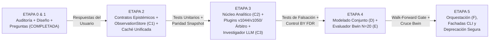

# PLAN DE REFACTORIZACIÓN INCREMENTAL — BET ENGINE

> **Regla de Oro de la Migración**: Cero rotura de flujos en producción (*Zero-Breakage Strangler Pattern*). Ningún archivo ni motor actual se elimina ni se desconecta hasta que el módulo equivalente en `bet_engine/` demuestre paridad o superioridad verificada mediante tests offline sobre snapshots reales.

---

## 1. SECUENCIA DE ETAPAS Y PUERTAS DE CONTROL (QUALITY GATES)

---

## 2. DETALLE DE CADA ETAPA DE IMPLEMENTACIÓN

### ETAPA 0 y ETAPA 1 — Auditoría Exhaustiva, Contratos y Alineación Arquitectónica *(ACTUAL — COMPLETADA)*
- **Entregables**:
  - [AUDITORIA_ARQUITECTURA_REAL.md](file:///Users/antonio/Projects/bet-tactical-engine/AUDITORIA_ARQUITECTURA_REAL.md)
  - [AUDITORIA_NUCLEO_ANALITICO.md](file:///Users/antonio/Projects/bet-tactical-engine/AUDITORIA_NUCLEO_ANALITICO.md)
  - [PROPUESTA_ARQUITECTURA_MODULAR.md](file:///Users/antonio/Projects/bet-tactical-engine/PROPUESTA_ARQUITECTURA_MODULAR.md)
  - [PREGUNTAS_ARQUITECTURA.md](file:///Users/antonio/Projects/bet-tactical-engine/PREGUNTAS_ARQUITECTURA.md)
  - [PLAN_REFACTORIZACION.md](file:///Users/antonio/Projects/bet-tactical-engine/PLAN_REFACTORIZACION.md)
- **Puerta de salida**: Respuesta del usuario a las 12 preguntas de `PREGUNTAS_ARQUITECTURA.md`.

---

### ETAPA 2 — Contratos Epistémicos (`bet_engine.contracts`), Caché Unificada (`bet_engine.acquisition`) y `ObservationStore` (`bet_engine.context`)
- **Objetivo**: Eliminar los 4 normalizadores incompatibles y los 4 clientes de caché sin tocar aún los comandos CLI existentes.
- **Tareas técnicas**:
  1. Crear `bet_engine/contracts/epistemic.py` con las 6 estructuras inmutables (`ObservedFact`, `StatisticalPattern`, `ContextualEvidence`, `TacticalHypothesis`, `ValidatedPattern`, `AcceptedModelFeature`) y validadores de esquema JSON.
  2. Crear `bet_engine/acquisition/api_client.py` unificando [`Phase1ApiClient`](file:///Users/antonio/Projects/bet-tactical-engine/prematch_phase1.py#L191) y [`SharedAPIRateLimiter`](file:///Users/antonio/Projects/bet-tactical-engine/generate_context.py#L860), con lectura transparente de las 3 cachés existentes (`outputs/.api_football_history_cache/`, `outputs/data/cache/` y `outputs/data/cache/preselect_api/`) para **no volver a pagar ni una sola llamada HTTP** ya descargada.
  3. Crear `bet_engine/context/observation_store.py` (`ObservationStore`) que construya la serie canónica `N=20` por equipo, jugador y árbitro:
     - Preservación estricta `None != 0` e integración con [`config/coverage_priority.json`](file:///Users/antonio/Projects/bet-tactical-engine/config/coverage_priority.json).
     - Cálculo de descanso real multicompetición (`rest_hours_all_comps`) y calendario posterior ($T+1$).
     - Etiquetado de cambios de entrenador (`coach_id`) y distorsión por tarjetas rojas tempranas ($<60'$).
     - Integración del perfil disciplinario del árbitro (`RefereeHistoryCollector`) y del cálculo de Strength of Schedule (`prematch_sos_v1044.py`).
- **Pruebas de verificación**:
  - Suite `test/test_epistemic_contracts.py` y `test/test_observation_store_offline.py` ejecutada 100% offline sobre snapshots existentes en `outputs/`.
- **Rollback**: Como Etapa 2 solo añade el paquete `bet_engine/{contracts,acquisition,context}` sin alterar los scripts de la raíz, el rollback es instantáneo y de riesgo cero.

---

### ETAPA 3 — Refactorización del Núcleo Analítico (`bet_engine.analytics`: `C2` + `C3`)
- **Objetivo**: Unificar el descubrimiento cuantitativo de patrones, las interacciones de variables y el bucle de investigación con Codex (`C3 <-> C2`).
- **Tareas técnicas**:
  1. Implementar `bet_engine/analytics/registry.py` (`PatternRegistry` + interfaz `PatternPlugin`).
  2. Migrar y consolidar como plugins modulares:
     - `MatchupVenuePlugin` (evolución de `prematch_pattern_discovery.py` + `prematch_tactical_signal_engine.py`).
     - `SoSAdjustedTrendPlugin` y `HalfDynamicsRedCardPlugin` (rescatados de la isla `v1044` / `v1046`).
     - `TacticalArchetypeClashPlugin` (rescatado de `prematch_tactical_intelligence_v1050.py`).
     - `RefereeDisciplinePlugin` (cruce de faltas/tarjetas de equipos con el perfil del árbitro).
     - `ScheduleFatigueRotationPlugin` (descanso multicompetición $<72\text{h}$, carga de minutos y lookahead $T+1$).
     - `PlayerRoleRate90Plugin` (evolución de `prematch_phase2.py`).
  3. Implementar `bet_engine/analytics/interaction_miner.py` separando los presupuestos `PREMATCH_TRIGGER` (100% observables en `cutoff_utc`) e `INTRA_MATCH_MECHANISM`, con validación adaptativa (LOOCV / Walk-Forward + Fisher + Benjamini-Yekutieli FDR) y chequeo de vigencia de régimen (`coach_id` / `squad_stability`).
  4. Implementar `bet_engine/analytics/tactical_investigator.py` (`C3`):
     - Generador de `TacticalResearchDossier` para Codex.
     - Evaluador determinista en Python de las hipótesis `TacticalHypothesis` (`python_test`) propuestas por Codex, devolviendo soporte exacto, lift y contraejemplos sobre `N=20`.
- **Pruebas de verificación**:
  - Tests unitarios por plugin + test de no-alucinación y rechazo de variables `POSTMATCH_ONLY` en predicados `PREMATCH_TRIGGER` + ejecución completa de `tools/run_offline_tests.py`.
- **Rollback**: Los motores antiguos (`prematch_pattern_discovery.py`, `prematch_tactical_signal_engine.py`, `prematch_advanced_discovery_v2.py`) permanecen intactos y pueden seleccionarse mediante flag `--legacy-analytics`.

---

### ETAPA 4 — Unificación de Modelización Probabilística (`bet_engine.modeling`) y Evaluador de Mercados Bwin sobre `N=20` (`bet_engine.markets`)
- **Objetivo**: Eliminar el truncamiento `P-1..P-6` de `motor_probabilistico.py` y unificar las 5 fórmulas de $\lambda$ en un único motor probabilístico calibrado.
- **Tareas técnicas**:
  1. Crear `bet_engine/modeling/` evolucionando [`prematch_predictive_engine.py`](file:///Users/antonio/Projects/bet-tactical-engine/prematch_predictive_engine.py) y [`prematch_international_expansion.py`](file:///Users/antonio/Projects/bet-tactical-engine/prematch_international_expansion.py):
     - Contracción Empirical Bayes + pooling jerárquico multicompetición cuando $n_{\text{exact}} < 8$.
     - Distribuciones Poisson / Binomial Negativa tanto para **mercados individuales por equipo** como para **totales conjuntos del partido** (Goles FT/H1, Córners FT/H1, Tarjetas, Remates, BTTS, 1X2).
     - Puerta de validación `WalkForwardGate` y registro congelado `config/accepted_model_features.json` para que ninguna correlación no validada contamine `p_model`.
  2. Crear `bet_engine/markets/` evolucionando el catálogo de mercados de [`motor_probabilistico.py`](file:///Users/antonio/Projects/bet-tactical-engine/motor_probabilistico.py) y [`prematch_market_mapping_v1.py`](file:///Users/antonio/Projects/bet-tactical-engine/prematch_market_mapping_v1.py):
     - Leer directamente del `ObservationStore` (`N=20`) en lugar de parsear `match_engine_<event>.txt` por regex (`P-1..P-6`).
     - Conservar intactas las salidas requeridas por `AGENTS.md` (`motor_probabilistico_<event>.json` y `.txt`, inventario completo de familias Bwin `ANALIZADO`, `NO IMPLEMENTADO`, `EVIDENCIA INSUFICIENTE`, `INAPLICABLE_PREMATCH`, `SIN_CUOTA`, `DESCARTADO`), pero enriquecidas con soporte sobre `N=20`, split localía, régimen de entrenador, SoS y distribución calibrada.
- **Pruebas de verificación**:
  - Comparación lado a lado (*shadow mode*) sobre partidos ya cerrados en `outputs/matches/<EVENT_ID>/`, verificando que todos los contratos de `validate_prematch.py` y `CODEX_<EVENT_ID>.md` se cumplen al 100%.
- **Rollback**: Flag `--legacy-motor-p6` en `motor_probabilistico.py` para restaurar el parser de texto `P-1..P-6` si fuera necesario.

---

### ETAPA 5 — Orquestación Unificada (`bet_engine.orchestration`), Fachadas CLI y Limpieza Segura
- **Objetivo**: Conectar los puntos de entrada habituales (`prematch_daily.py`, `prematch_single.py`, `prematch_multi.py`) al nuevo pipeline modular y archivar el código obsoleto sin romper un solo comando ni test.
- **Tareas técnicas**:
  1. Conectar `prematch_daily.py`, `prematch_single.py` y `prematch_multi.py` a `bet_engine.orchestration` manteniendo idénticos sus argumentos CLI y rutas de salida (`outputs/daily/<date>/` y `outputs/matches/<EVENT_ID>/`).
  2. Verificar que las **67 suites de test** en `test/` y `tools/run_offline_tests.py` pasan al 100%.
  3. Solo tras confirmar cero consumidores activos y tests en verde: eliminar los 3 archivos `.bak` y mover los scripts de diagnóstico puntuales sin consumidores a `tools/diagnostics/`.
