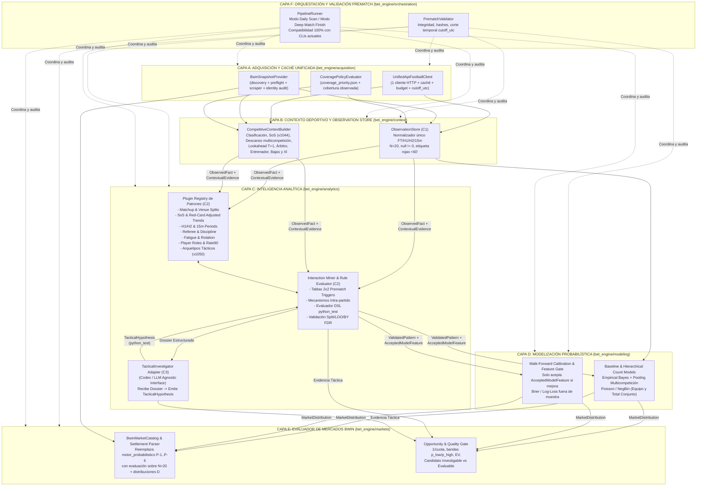

# PROPUESTA DE ARQUITECTURA MODULAR — EVALUACIÓN CRÍTICA Y DISEÑO OBJETIVO

> **Principio rector**: No reorganizar archivos en carpetas por estética, ni aceptar acríticamente la división inicial en 6 módulos (A–F). Donde la hipótesis inicial introduce acoplamiento oculto o repite errores actuales del repositorio, **la refutamos y proponemos una alternativa técnicamente superior**.

---

## 1. EVALUACIÓN CRÍTICA Y REFUTACIONES A TUS DECISIONES INICIALES (SECCIÓN 8)

### Refutación 1: ¿Conviene un "Núcleo Analítico Único" (Módulo C monolítico)?
- **Tu hipótesis inicial**: Tener un único módulo **C. Inteligencia analítica** que combine minería cuantitativa en Python, detección de tendencias, interpretación táctica con LLM, generación de hipótesis y detección de contradicciones.
- **Por qué lo refuto**: En el código actual, mezclar el almacenamiento/normalización de series históricas, el cálculo determinista de señales y la integración con el LLM es exactamente lo que provocó los ciclos de importación entre [`prematch_tactical_history.py`](file:///Users/antonio/Projects/bet-tactical-engine/prematch_tactical_history.py), [`prematch_tactical_signal_engine.py`](file:///Users/antonio/Projects/bet-tactical-engine/prematch_tactical_signal_engine.py) y [`prematch_daily.py`](file:///Users/antonio/Projects/bet-tactical-engine/prematch_daily.py). Además, un módulo C monolítico acopla la velocidad determinista de Python (milisegundos por partido en escaneo diario de 40 fixtures) con la latencia/coste del LLM (segundos o intervención manual en los top candidatos).
- **Alternativa técnicamente superior**: Dividir **C** en **tres submódulos especializados con dependencias estrictamente unidireccionales**:
  - **C1. `ObservationStore` (Almacén Canónico de Observaciones Point-in-Time)**: Único responsable de transformar los snapshots crudos de **A (Adquisición)** y **B (Contexto Deportivo)** en registros `ObservedFact` y `ContextualEvidence` bajo corte temporal estricto (`asof_utc <= cutoff_utc`). Reemplaza los **4 normalizadores incompatibles** que hoy existen en el proyecto.
  - **C2. `QuantitativePatternEngine` (Motor Determinista de Patrones, Interacciones y Validación)**: 100% Python puro, sin llamadas a red ni LLM. Ejecuta un registro extensible de *Descubridores de Patrones* (plantillas tácticas de dominio + minería combinatoria de interacciones + evaluador del DSL `python_test`) y aplica validación temporal (Split/Walk-Forward, LOO, BY FDR, chequeo de régimen de entrenador/XI) para emitir `StatisticalPattern` y `ValidatedPattern`.
  - **C3. `TacticalInvestigator` (Adaptador Agéntico / LLM)**: Consume un dossier estructurado de `C1 + C2`, propone objetos `TacticalHypothesis` con predicados ejecutables `python_test` y los devuelve a **C2** para que Python los verifique o refute con datos reales.

### Refutación 2: ¿Dónde debe participar el LLM — antes o después del modelado estadístico?
- **El falso dilema**: Si el LLM entra **solo antes** del modelado estadístico en los 50 partidos del día, el coste/tiempo se dispara y el LLM analiza partidos donde Bwin ni siquiera ofrece líneas líquidas o donde no hay ninguna divergencia con el mercado. Si el LLM entra **solo al final** (como hoy hace `CODEX_<event>.md`), ya no puede pedirle a Python que contraste una nueva hipótesis de interacción sobre la base de datos histórica (`N=20`), quedando reducido a un comentarista de texto sobre 6 partidos (`P-1..P-6`).
- **Alternativa técnicamente superior (Arquitectura en Dos Etapas Focalizadas)**:
  1. **Barrido Diario 100% Python (`C1 -> C2 -> D -> E`)**: En el escaneo masivo diario, Python ejecuta descubrimiento cuantitativo (`C2`), modelado probabilístico base (`D`) y cruce preliminar con cuotas (`E`) para filtrar los **Top $K$ partidos/mercados candidatos** ($K \approx 3\text{–}8$).
  2. **Bucle de Investigación Profunda sobre Candidatos (`C3 <-> C2 -> D/E -> Decisión Final Codex`)**: Solo para los partidos seleccionados:
     - **Paso 2A (Generación y Conciliación de Hipótesis)**: El LLM (`C3`) recibe el dossier completo (`N=20`, perfiles de jugadores, bajas, árbitro, SoS y reporte cualitativo externo), reconcilia cambios de régimen (nuevo entrenador, rotación esperada) y emite hipótesis ejecutables `TacticalHypothesis` (`python_test`).
     - **Paso 2B (Falsación Determinista en Python)**: `C2` ejecuta esos tests sobre el `ObservationStore` (`N=20`) y calcula soporte real, lift y contraejemplos.
     - **Paso 2C (Evaluación Táctica Final)**: Con las hipótesis ya falsadas/corroboradas por Python y las probabilidades/cuotas calculadas por `D` y `E`, Codex realiza el juicio táctico final (`PICK` vs `NO BET`).

### Refutación 3: Minería a ciegas de correlaciones intra-partido vs. Condicionales Prepartido + Mecanismos
- **Problema actual**: [`prematch_advanced_discovery_v2.py`](file:///Users/antonio/Projects/bet-tactical-engine/prematch_advanced_discovery_v2.py#L362-L407) gasta casi todo su presupuesto (`max_tests=64`) probando si una variable **post-kickoff** (`own.shots > mediana`) se asocia con otra variable **post-kickoff** (`own.corners > mediana`). Eso obliga a bloquear su uso predictivo (`SAME_MATCH_POST_KICKOFF_VARIABLE`) porque antes del partido no sabemos cuántos tiros hará el equipo hoy.
- **Alternativa técnicamente superior**: Separar en `C2` dos presupuestos de descubrimiento distintos:
  1. **Descubridor de Condicionales Prepartido (`PREMATCH_TRIGGER`)**: Todas las variables de la condición $X$ **deben estar observadas en `cutoff_utc`** (medias móviles `lag.own.*`, perfil de concesión del rival en últimos 5 partidos, arquetipo táctico rival, `venue`, `rest_hours_all_comps`, `opponent_sos_rating`, `referee_cards_avg`, `coach_regime`, `standings_need`). Estos patrones **sí son candidatos legítimos** a `ValidatedPattern` y `AcceptedModelFeature`.
  2. **Verificador de Mecanismos Intra-Partido (`INTRA_MATCH_MECHANISM`)**: Evalúa cadenas causales internas (`centros -> tiros bloqueados -> córners`, `posesión estéril -> pocos tiros a puerta`, `faltas en campo rival -> tarjetas`) no como triggers directos de probabilidad, sino para **corroborar si el mecanismo táctico de una hipótesis es real en ese equipo**.

### Refutación 4: Funcionalidades de alto valor que YA existen en tu código y NO debemos reconstruir desde cero
En lugar de programar desde cero nuevos motores tácticos, la auditoría reveló que el repositorio **ya tiene programados (pero desconectados o infrautilizados)** cinco componentes críticos que debemos integrar directamente en `B`, `C1` y `C2`:
1. **Strength of Schedule (SoS) con contracción bayesiana**: Ya existe en [`prematch_sos_v1044.py:120-260`](file:///Users/antonio/Projects/bet-tactical-engine/prematch_sos_v1044.py#L120-L260). Debe integrarse en `C1/C2` para que toda métrica de equipo tenga tanto su media cruda como su media ajustada por la calidad de los rivales enfrentados.
2. **Detección de distorsión por tarjeta roja temprana (`red_card_minute < 60`) y dinámicas H1 vs. H2**: Ya existen en [`prematch_integral_analysis_v1046.py`](file:///Users/antonio/Projects/bet-tactical-engine/prematch_integral_analysis_v1046.py) y [`match_performance_engine.py`](file:///Users/antonio/Projects/bet-tactical-engine/match_performance_engine.py). Un partido donde un equipo jugó 70 minutos con 10 hombres distorsiona brutalmente sus medias de córners, tiros y posesión si no se etiqueta en `ObservedFact`.
3. **Arquetipos tácticos y choque de estilos (`DOMINADOR_ESTERIL`, `ASEDIO_CONSTANTE`, `TRANSICION_VERTICAL`, `BLOQUE_BAJO_REACTIVO`)**: Ya existen en [`prematch_tactical_intelligence_v1050.py`](file:///Users/antonio/Projects/bet-tactical-engine/prematch_tactical_intelligence_v1050.py). Deben convertirse en un plugin de dominio dentro de `C2`.
4. **Perfil histórico del árbitro (`RefereeHistoryCollector`)**: Ya existe en [`generate_context.py:2221-2435`](file:///Users/antonio/Projects/bet-tactical-engine/generate_context.py#L2221-L2435), pero hoy solo imprime texto en `.txt`. Debe moverse a `B (Contexto Deportivo)` para emitir `ObservedFact` y `ContextualEvidence` consumibles por los patrones de tarjetas/faltas.
5. **Pooling jerárquico multicompetición con decaimiento temporal**: Ya existe en [`prematch_international_expansion.py:28-88`](file:///Users/antonio/Projects/bet-tactical-engine/prematch_international_expansion.py#L28-L88). Debe integrarse en `C2` y `D` para resolver la falta de muestra en Champions, Europa League, Copas y selecciones sin mezclar ciegamente torneos.

---

## 2. ARQUITECTURA MODULAR OBJETIVO Y FLUJO DE DATOS UNIDIRECCIONAL

### 2.1 Diagrama de Capas y Contratos



### 2.2 Regla de Dependencias Unidireccionales (Cero Ciclos)

El grafo de importaciones entre paquetes queda gobernado por una jerarquía estricta de niveles donde **un módulo de nivel inferior jamás puede importar de un nivel superior**:

1. `bet_engine.contracts` (Nivel 0: dataclasses inmutables `ObservedFact`, `StatisticalPattern`, `ContextualEvidence`, `TacticalHypothesis`, `ValidatedPattern`, `AcceptedModelFeature`, esquemas y validación de tipos). **No importa de ningún otro paquete del proyecto.**
2. `bet_engine.acquisition` (Nivel 1: cliente API-Football unificado, Bwin scraper/discovery, política de cobertura). Solo importa `contracts`.
3. `bet_engine.context` (Nivel 2: `ObservationStore`, `RefereeProfileBuilder`, `SoSEngine`, `ScheduleFatigueBuilder`, `LineupInjuryReconciler`). Importa `contracts` y lee snapshots de `acquisition`.
4. `bet_engine.analytics` (Nivel 3: `PatternRegistry`, plugins de patrones, `InteractionMiner`, `RuleEvaluator`, `TacticalInvestigator`). Importa `contracts` y `context`.
5. `bet_engine.modeling` (Nivel 4: modelos Poisson/NegBin por equipo y totales conjuntos, pooling multicompetición, walk-forward gate). Importa `contracts`, `context` y `analytics`.
6. `bet_engine.markets` (Nivel 5: mapeo completo del catálogo Bwin, frecuencias sobre `N=20` y cruce con distribuciones de `modeling`). Importa `contracts`, `analytics` y `modeling`.
7. `bet_engine.orchestration` (Nivel 6: runners, validadores prepartido, generadores de reportes y fachadas CLI).

---

## 3. EXTENSIBILIDAD ABIERTA: CÓMO AÑADIR NUEVAS FAMILIAS DE PATRONES SIN TOCAR EL ORQUESTADOR

Para cumplir tu requisito de *"admitir nuevas familias de patrones sin tener que reescribir todo el motor"*, `bet_engine.analytics` implementará el patrón **Open-Closed Plugin Registry**:

```python
class PatternPlugin(Protocol):
    plugin_id: str
    domain_family: str  # "CORNERS", "CARDS_REFEREE", "SHOTS", "FATIGUE_ROTATION", "COACH_SYSTEM", "H1_H2", etc.
    required_coverage: tuple[str, ...]

    def discover(
        self,
        store: ObservationStore,
        context: MatchContextBundle,
    ) -> list[StatisticalPattern | TacticalHypothesis]: ...
```

- Cuando quieras añadir una familia nueva (por ejemplo, **"Vulnerabilidad a centros laterales cuando falta el central titular aéreo"** o **"Tarjetas del lateral cuando enfrenta a un extremo en el top 10% de regates por 90m"**), simplemente creas un archivo en `bet_engine/analytics/plugins/` que implemente `PatternPlugin` o declaras la plantilla en el catálogo JSON del DSL.
- El `QuantitativePatternEngine` descubre automáticamente todos los plugins registrados, verifica primero en `store` si las métricas en `required_coverage` están disponibles para ese partido/liga (si no lo están, emite `SKIPPED_MISSING_COVERAGE` de forma limpia sin fallar) y somete todos los patrones generados al mismo pipeline centralizado de validación temporal (`LOO`, `Split/Walk-Forward`, `BY FDR` y chequeo de régimen).

---

## 4. INDEPENDENCIA DEL PROVEEDOR LLM (SUSTITUCIÓN DE CODEX POR OTRO LLM)

El submódulo `C3 (TacticalInvestigator)` define un puerto abstracto (`LLMInvestigatorPort`) que opera **exclusivamente mediante contratos JSON/Markdown deterministas**:
- **Entrada al puerto**: `TacticalResearchDossier` (serializable a JSON y a Markdown estructurado).
- **Salida del puerto**: `TacticalInvestigationResult` (validado contra el esquema de `TacticalHypothesis` y `python_test`).
- **Adaptadores intercambiables**:
  1. `FileHandoffInvestigatorAdapter`: Genera el archivo de dossier/prompt para ejecución asistida o manual (compatible con el flujo actual de `CODEX_<event>.md` y `llm_research_package.json`).
  2. `CLIAgentInvestigatorAdapter`: Invoca por subproceso local a `codex`, `gemini` o cualquier binario CLI configurado, pasándole el dossier en modo solo lectura sobre los snapshots locales y validando automáticamente el JSON devuelto.
  3. `NullInvestigatorAdapter`: Permite correr todo el pipeline 100% en Python (`--no-llm`) sin romper ninguna etapa posterior.

---

## 5. ELIMINACIÓN DEL TRUNCAMIENTO `P-1..P-6` EN `motor_probabilistico.py`

Uno de los mayores saltos de calidad analítica de esta arquitectura es **eliminar la dependencia de `motor_probabilistico.py` respecto al parseo por regex del texto `match_engine_<event>.txt` (`P-1..P-6`)**:

1. `generate_context.py` seguirá generando `match_engine_<event>.txt` para lectura humana/auditoría y `match_engine_<event>.json`, pero el historial estructurado del partido conservará las **20 observaciones completas (`N=20`)** ya recolectadas en caché desde `preselect_matches.py` / `prematch_phase1.py` (cero llamadas extra a la API si ya están en la caché unificada).
2. `motor_probabilistico.py` (integrado en `bet_engine.markets` + `bet_engine.modeling`) evaluará todos los mercados del snapshot de Bwin sobre la ventana completa parametrizable (`N=20` global, `N=10` reciente, `same_competition`, `venue_specific`, y `coach_regime_active`), integrando además las distribuciones Poisson/NegBin con contracción Empirical Bayes de `prematch_predictive_engine.py`, el ajuste SoS de `v1044` y el perfil del árbitro de `generate_context.py`.
